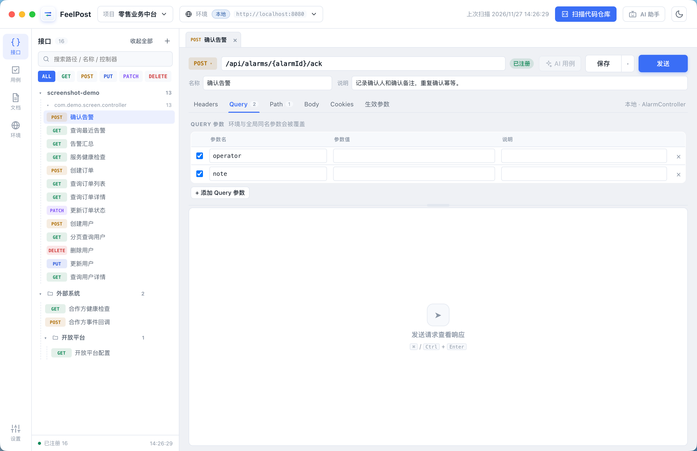
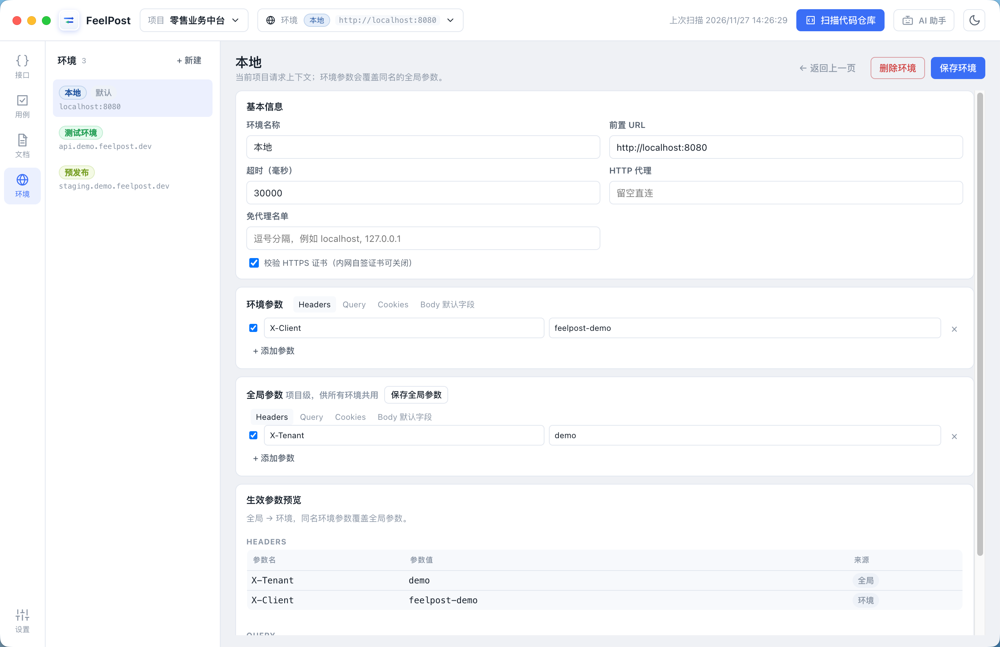

<p align="center">
  
</p>

<h1 align="center">FeelPost</h1>

<p align="center">
  本地优先的 Spring Boot 接口契约中枢<br />
  扫描源码 · 调试接口 · 沉淀用例 · 导出可交付的 Markdown 文档
</p>

<p align="center">
  <a href="https://github.com/SmileEmile/feelpost/releases"></a>
  <a href="https://github.com/SmileEmile/feelpost/actions/workflows/build.yml"></a>
  
  
  
  <a href="LICENSE"></a>
</p>

FeelPost 是一个运行在本机的桌面工具，用来把 Spring Boot 后端接口从源码整理成前端可以直接使用的契约文档。

它不依赖云端服务，项目、接口、环境、用例和响应示例都保存在本地。AI 是可选项，不开启 AI 也能完成扫描、调试、用例和普通 Markdown 导出。

## 截图

| 接口调试 | 用例管理 | 环境配置 |
| --- | --- | --- |
|  |  |  |

## 核心能力

- **源码扫描**：解析 Spring Boot Controller、请求方法、路径、参数、DTO、Javadoc 和校验注解。
- **接口资产**：按模块 / 包 / 手工目录组织接口，支持搜索、方法筛选、变更确认和人工校正。
- **本地调试**：编辑 Path、Query、Header、Body、Cookie，按环境执行请求，查看响应、耗时、大小和状态。
- **环境管理**：前置 URL、TLS、代理、超时、环境参数和全局参数，支持参数合并预览。
- **用例沉淀**：把当前请求冻结为用例，保留标签、备注、请求快照和响应示例。
- **文档导出**：按接口生成 Markdown，支持筛选、预览、源码查看、复制、导出和渐进加载。
- **字段说明**：手动填写字段说明，或用 AI 生成 Diff 后选择性应用。
- **AI 用例**：根据接口契约生成候选用例，预览、调整标签后导入当前环境。
- **AI 联调文档**：按标签选择用例，按接口分批生成结构化 Markdown，支持本地缓存和失败批次重试。
- **普通导出**：不调用 AI，直接导出已保存用例的请求和响应信息。
- **本地优先**：无登录、无云端依赖；API Key 使用系统安全存储。

## 下载

从 [Releases](https://github.com/SmileEmile/feelpost/releases) 下载对应平台安装包：

- macOS：`.dmg`（Apple Silicon / Intel）
- Windows：NSIS 安装包 `.exe`
- Windows Portable：免安装 `.exe`

当前安装包未做代码签名，首次运行可能被系统提示；正式分发前需要补签名。

## 快速开始

要求：

- Node.js >= 20
- macOS 或 Windows

```bash
git clone https://github.com/SmileEmile/feelpost.git
cd feelpost
npm install
npm run dev
```

开发模式会启动 Electron 主进程、preload 和 React 界面。

## 使用流程

1. 新建项目，选择本地 Spring Boot 源码目录。
2. 扫描代码仓库，确认接口候选并入库。
3. 配置本地/测试/生产环境。
4. 打开接口，编辑参数并发送请求。
5. 保存响应示例，把请求保存为用例。
6. 在文档页预览和导出 Markdown。
7. 如需 AI，在设置中配置模型服务商后使用字段说明、AI 用例和 AI 文档导出。

## AI 配置

FeelPost 使用 OpenAI-compatible 接口，支持主流国内外服务商：

- DeepSeek
- 通义千问
- 智谱 GLM
- Kimi
- SiliconFlow
- Ollama（本地）
- OpenAI
- Anthropic Claude
- Google Gemini
- OpenRouter
- 自定义 / 兼容接口

设置页可以选择服务商，自动填入 Base URL 和默认模型；点击「获取模型」可从服务商 `/models` 接口拉取可用模型。通常只需要填写 API Key。

AI 相关行为：

- AI 默认关闭，核心功能不依赖 AI；
- 请求前会展示脱敏后的上下文，不发送源码；
- API Key 只保存在本机；
- 发送前会剔除敏感 Header、Cookie 和查询参数；
- AI 结果先预览，不会自动写入接口资产；
- 修改配置后需要重新测试连接。

## 数据与隐私

默认数据目录：

```text
~/Documents/feelpost
```

可以通过环境变量覆盖：

```bash
FEELPOST_DATA_DIR=/path/to/data
```

数据全部是本地 JSON 文件，可以直接整目录备份或迁移。应用不包含账号系统、云同步或远程遥测。

> 注意：扫描只读取源码文件，不执行源码；请求会按你配置的环境真实发送到目标地址。

## 技术架构

```text
┌─────────────────────────────────────────────┐
│ Electron Renderer                           │
│ React 18 · TypeScript · CSS                 │
└──────────────────────┬──────────────────────┘
                       │ window.feelpost
┌──────────────────────▼──────────────────────┐
│ Preload                                     │
│ contextBridge · typed IPC API               │
└──────────────────────┬──────────────────────┘
                       │ IPC + zod validation
┌──────────────────────▼──────────────────────┐
│ Electron Main                               │
│ Project / Catalog / Environment / Request   │
│ Case / Example / Document / AI / Settings   │
│                                              │
│ ScanService ── worker_threads ── tree-sitter│
└──────────────────────┬──────────────────────┘
                       │ atomic JSON files
                       ▼
              ~/Documents/feelpost
```

技术栈：

- Electron 33
- React 18 + Vite 5
- TypeScript 5
- electron-vite
- web-tree-sitter（Java WASM grammar）
- undici
- zod
- electron-log

扫描在独立 `worker_threads` 中运行，主进程只负责调度、进度转发和结果入库。

## 开发

```bash
npm install

npm run dev        # 开发模式
npm run typecheck  # 类型检查
npm test           # 单元测试
npm run build      # 构建 main / preload / renderer
```

测试覆盖：

- 参数合并与接口指纹
- 项目与本地存储
- Java 扫描与候选 diff
- 环境、设置、用例、响应示例
- AI 缓存与取消

当前测试数量：**73 个**。

## 打包

```bash
npm run pack     # 当前系统安装包：macOS DMG / Windows NSIS
npm run dist     # 当前系统完整产物
npm run dist:mac # macOS DMG + ZIP（arm64 / x64）
npm run dist:win # Windows NSIS + Portable（x64）
```

GitHub Actions 在以下情况会自动构建并发布 GitHub Release：

- 手动运行 `build` workflow；
- 推送 `v*` 标签。

Release 会包含：

```text
FeelPost-<version>-arm64.dmg
FeelPost-<version>-x64.dmg
FeelPost-<version>-arm64.zip
FeelPost-<version>-x64.zip
FeelPost-<version>-x64-Setup.exe
FeelPost-<version>-x64-Portable.exe
```

## 目录结构

```text
src/
├── main/                 Electron 主进程
│   ├── index.ts          窗口、生命周期
│   ├── ipc/              IPC 注册与参数校验
│   ├── services/         业务服务
│   ├── scanner/          Java 扫描器与 Worker
│   └── storage/          JSON 存储与路径
├── preload/              contextBridge API
├── renderer/             React 界面
├── core/rules/           纯领域规则
└── shared/contract.ts    IPC 契约类型
docs/                     设计文档与实现快照
resources/                图标、grammar 等打包资源
tests/                    Vitest 单元测试
```

## 文档

- [当前实现现状](docs/实现现状-2026-11-25.md)
- 设计过程记录见 `docs/design/01–07`；当前实现以上面的现状文档为准。

## 已知限制

- 当前安装包未签名、未公证；
- 只支持本地单用户使用，不提供团队协作或云同步；
- 扫描基于 tree-sitter 静态分析，动态生成的接口或复杂泛型可能需要人工校正；
- AI 功能需要用户自行配置兼容 OpenAI 风格的服务商。

## 贡献

欢迎提交 Issue 和 Pull Request。

提交前请至少运行：

```bash
npm run typecheck
npm test
npm run build
```

如果是界面改动，建议附上修改前后的截图。

## 支持项目

FeelPost 开源免费，任何人都可以自由下载、使用、修改和分发。

如果这个项目对你有帮助，欢迎自愿打赏支持作者持续维护开发。打赏完全自愿，不提供额外功能、权限或服务承诺。

## License

本项目采用 [MIT License](LICENSE) 开源。

Copyright (c) 2026 Emile
