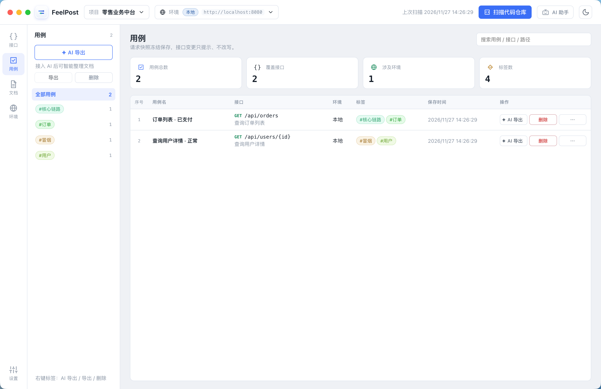

# FeelPost

面向 AI 协作开发的本地接口契约中枢：从 Spring Boot 源码产接口契约，本机调试，导出 md 给 AI 前端。

> 当前阶段：**内部 Alpha**。扫描 → 接口资产 → 环境 → 调试 → 用例 → 文档/导出主链路已完成，正在做产品化收尾。

## 技术栈

- Electron 33 + React 18 + TypeScript 5
- electron-vite（主进程 / preload / 渲染进程三端构建）+ Vite 5
- 本地 JSON 文件存储（原子写）
- zod 校验 IPC 入参；electron-log 日志
- web-tree-sitter（WASM）Java 扫描、undici 请求引擎
- 进行中：AI 模块（Phase 0–3 已完成：字段说明 Diff、AI 用例；前端交付统一走用例 AI 导出）、代码签名 / 公证

## 环境要求

- Node.js **>= 20**（仓库内的 `.tools/` 是本机自带的 Node 22，已被 `.gitignore` 忽略，不随仓库分发）
- macOS / Windows

```bash
# 本机系统 Node 是 14，可用仓库内工具链：
export PATH="$PWD/.tools/node/bin:$PATH"

npm install
npm run dev        # 启动 Electron 开发模式
```

> 如果终端里存在 `ELECTRON_RUN_AS_NODE=1`，Electron 会以 Node 模式启动而不是应用：
> 先 `unset ELECTRON_RUN_AS_NODE` 再执行 `npm run dev`。

## 常用命令

| 命令 | 说明 |
|---|---|
| `npm run dev` | Electron 开发模式（渲染进程 HMR） |
| `npm run build` | 构建 main / preload / renderer 到 `out/` |
| `npm run typecheck` | 主进程与渲染进程 TypeScript 检查 |
| `npm test` | Vitest 单元测试（领域规则 + 项目存储） |
| `npm run release:check` | 校验版本号并生成 `release-notes.md` |
| `npm run pack` / `npm run dist` | electron-builder 打包（未签名） |

## 环境变量

| 变量 | 用途 |
|---|---|
| `FEELPOST_DATA_DIR` | 覆盖数据目录，默认 `~/Documents/feelpost` |
| `FEELPOST_SMOKE=1` | 隐藏窗口启动、渲染完成后输出检查结果并退出，用于 CI 冒烟 |
| `FEELPOST_LOG_DIR` | 覆盖日志目录（受限环境或测试用） |
| `ELECTRON_MIRROR` | 安装时指定 Electron 下载镜像（如 `https://npmmirror.com/mirrors/electron/`） |
| `electron_config_cache` | 安装时把 Electron 二进制缓存放到可写目录（受限环境用） |

## 目录结构

```text
src/
├── main/                 Electron 主进程（应用服务 + 适配器）
│   ├── index.ts          启动、窗口、生命周期
│   ├── ipc/register.ts   通道注册、zod 校验、结果包络
│   ├── services/         Project / Settings 服务
│   └── storage/          JSON 原子读写、路径
├── preload/index.ts      contextBridge 暴露类型化 API
├── renderer/             React 界面（项目列表 / 新建项目 / 工作区壳）
├── core/rules/           纯领域规则：参数合并、指纹、状态机
└── shared/contract.ts    IPC 契约类型（Result / 错误码 / DTO）
tests/unit/               Vitest 单元测试
resources/                打包资源
docs/design/              01–07 设计文档
prototype/                可交互页面原型
```

## 已完成

- 项目列表、新建项目（源码目录可稍后选择）、项目工作区；未设置源码目录时点击扫描会先弹出目录选择并回写项目；项目设置支持名称/描述/源码目录/排除规则修改与删除；项目卡片支持删除（二次确认，级联清空项目目录下全部数据）；
- 项目数据按数据模型 03 落盘：`projects/<id>/project.json`、`environments.json`、`globals.json`、`interfaces/`、`cases/`、`scan/`；AI 接入文档功能已下线，不再写入或读取 `ai-docs/`；
- 默认环境生成、目录校验（构建文件 + Controller 计数）、重名目录冲突检测、删除级联；
- **源码扫描**：扫描在独立 `worker_threads` 中执行，tree-sitter Java grammar（WASM）解析 Controller / 路径 / 参数 / DTO / Javadoc / 校验注解；支持整个工程、指定目录与 Maven 模块多选；进度事件、取消、候选 diff、授权入库；
- **接口语义**：优先读取 `@ApiOperation.value` / `@Operation(summary)` 作为接口名称，`@SysLog.value`、Javadoc 兜底；字段说明读取 `@ApiModelProperty.value` / `@Schema.description`；`JSONObject`、`Map` 等动态请求体按空 JSON 处理，不误报解析失败；
- **接口资产**：按原型实现工作台（左轨、搜索/方法筛选、模块树）、接口契约、解析完整度、变更说明、确认变更、恢复归档；左侧树优先显示扫描出的接口名称，无名称时显示路径最后一段；列表区域独立滚动，方法以彩色标签展示；
- **人工校正**：字段级覆盖（类型/必填/说明）+ 接口补充说明，写入人工层，扫描不覆盖；
- 扫描快照与最近一次扫描摘要落盘（`scan/snapshot.json`、`scan/last-run.json`）；
- 请求日志输出到终端 `[FeelPost:http]` 与数据目录 `logs/requests.log`，包含 URL、Header、Body、状态码、耗时与错误原因（敏感 Header 脱敏）；
- **环境**：独立环境工作区，环境新建/切换/删除/设为默认；前置 URL / 超时 / 证书校验 / 代理 / 免代理名单；环境参数与项目级全局参数编辑；生效参数合并预览；
- **请求执行**：undici 发送、按环境 TLS/代理/超时、取消、响应状态/耗时/大小/正文/响应头/响应示例、按耗时给出动态速度评价、简化 JSON、响应区直接保存成功/失败响应示例、查看示例、复制 curl；请求区按 Headers / Query / Path / Body / Cookies / 生效参数排列，生效参数按卡片分组展示、空参数自动收起；表格式标签默认两行空数据、空键不参与发送，参数说明可直接编辑；Body 支持 none / raw（JSON、Text）/ form-data（含文件）/ urlencoded / binary，JSON 请求体与响应体带语法高亮、行号与格式化；接口名称与说明支持点击后手动编辑，写入人工层，名称会同步到左侧接口树；顶部「保存」拆分为保存接口信息 + 下拉保存用例，支持 ⌘/Ctrl+S 快捷键；保存会同时写入 Path/Query/Header/Cookie/Body 请求参数，以及当前响应示例（简化模式下保存简化内容），切换接口或重启后自动回填；
- **用例**：保存当前请求为冻结快照、列表/标签筛选/关键词搜索、序号、详情、改名、复制、删除、按标签批量删除、按标签选择后 AI 导出联调文档（按接口分批生成、超限拆用例、合并为一个 MD，参数与响应示例未变化时复用本地缓存）；接口变更与环境删除会给出提示；
- **文档**：项目级按接口组织的 Markdown，包含环境与全局参数、生效 Header/Query/Cookie、请求体字段说明与响应示例；支持预览 / 源码切换、范围与手工接口开关、按名称/方法/路径/状态/模块筛选、复制与导出；单个接口 6 块 Markdown 导出；绝对 http(s) 接口地址导出时不再拼接环境前缀；
- **字段描述**：请求体自定义 JSON 与响应 JSON 都可从当前内容生成字段路径/类型/示例，逐字段填写说明并持久化；
- **用例导出**：必须选择标签后才能 AI 导出；AI 基于现有请求快照、接口契约和响应示例生成可交付 Markdown，文档包含请求头、入参、响应参数表格；
- IPC 契约子集：项目 / 设置 / 目录选择 / 扫描 / 接口资产 / 环境 / 请求 / 用例 / 响应示例 / 导出，含扫描事件；
- 领域规则：三层参数合并（Body 仅补缺）、接口指纹、状态机，单测覆盖；
- **应用设置**：浅色/深色主题、全局缩放比例（80%–150%，持久化）、数据目录与日志目录打开、调试日志开关、版本与平台信息；AI 设置支持国内外主流服务商预设、自动填入 URL/模型、获取模型列表；
- 深/浅主题切换并持久化。



## 尚未实现

- 更多文档模板；
- 代码签名 / 公证、GUI 自动化测试。

## 验证状态

- `npm run typecheck` 通过
- `npm test`：71 个单测通过（规则 / 项目 / 扫描 / 资产 / 环境 / 设置 / 请求体 / 用例 / 响应示例 / JSON 简化 / 速度分级）
- `npm run build` 通过（main / preload / renderer）
- 打包配置与 CI 已接入：macOS DMG/ZIP、Windows NSIS/Portable；`npm run pack` 按系统生成 DMG 或 exe；未签名
- 渲染冒烟通过：主进程、preload、React 页面均正常加载（`hasApi: object`、`hasApp: true`）
- **端到端扫描冒烟通过**：创建项目 → 扫描 `tests/fixtures/demo-spring` → 3 个候选 → 入库 → 资产树出现 `demo-spring` 模块
- **端到端请求冒烟通过**：本地 HTTP 服务收到 `GET /api/users/42?keyword=alice`，界面显示 `200 OK` 与响应体

无图形会话的环境可用 headless 方式验证：

```bash
unset ELECTRON_RUN_AS_NODE
FEELPOST_SMOKE=1 \
FEELPOST_DATA_DIR="$PWD/.tmp-data" \
FEELPOST_LOG_DIR="$PWD/.tmp-data/logs" \
./node_modules/.bin/electron --headless --no-sandbox --disable-gpu out/main/index.js
```

> 当前执行环境没有常驻 WindowServer，直接启动 GUI 会 `SIGTRAP`；在本地桌面终端用 `npm run dev` 即可正常开窗。
> UI 基础组件先用原生 React/CSS，Radix 与完整设计系统在与 04 页面逐页对接时引入。

## 文档索引

- **当前实现状态（权威）**：[`docs/实现现状-2026-11-25.md`](docs/实现现状-2026-11-25.md)
- **版本与发布规则**：[`VERSIONING.md`](VERSIONING.md)
- **版本升级说明**：[`CHANGELOG.md`](CHANGELOG.md)
- 以下 01–07 为设计过程记录；与当前实现冲突处以实现现状为准。

## 设计依据

- `docs/design/01.功能模块梳理.md`
- `docs/design/02.整体架构设计.md`
- `docs/design/03.数据模型设计.md`
- `docs/design/04.页面与交互设计.md`
- `docs/design/05.IPC契约设计.md`
- `docs/design/06.AI模块详细设计.md`
- `docs/design/07.AI实现评审.md`


## 打包

- GitHub Actions 手动运行或推送 `v*` 标签时，会在 macOS / Windows 构建完成后自动创建 / 更新 GitHub Release，并上传 dmg、zip、exe。

- macOS：`npm run dist:mac:arm64`（本机 arm64）/ CI `--mac --arm64 --x64`
- Windows：Windows runner 上运行 `npm run dist:win`
- 产物：`FeelPost-<version>-<arch>.dmg`、`FeelPost-<version>-<arch>.zip`、`FeelPost-<version>-x64-Setup.exe`、`FeelPost-<version>-x64-Portable.exe`
- 当前未签名：macOS 正式分发需 Developer ID + notarization，Windows 建议 Authenticode 签名
