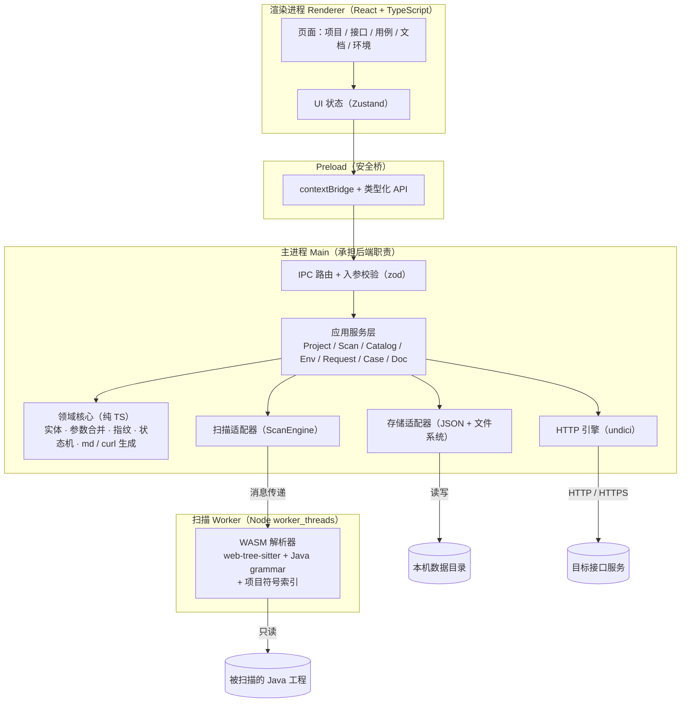
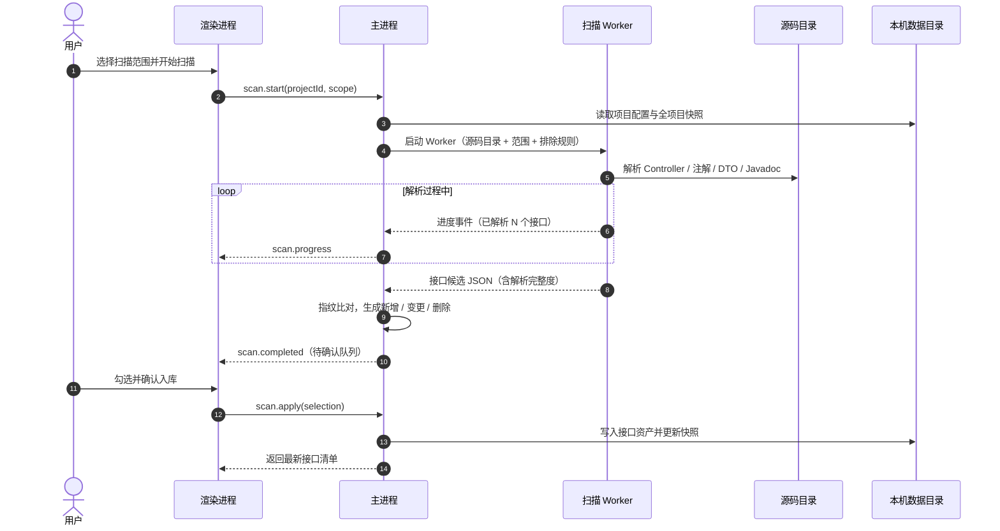
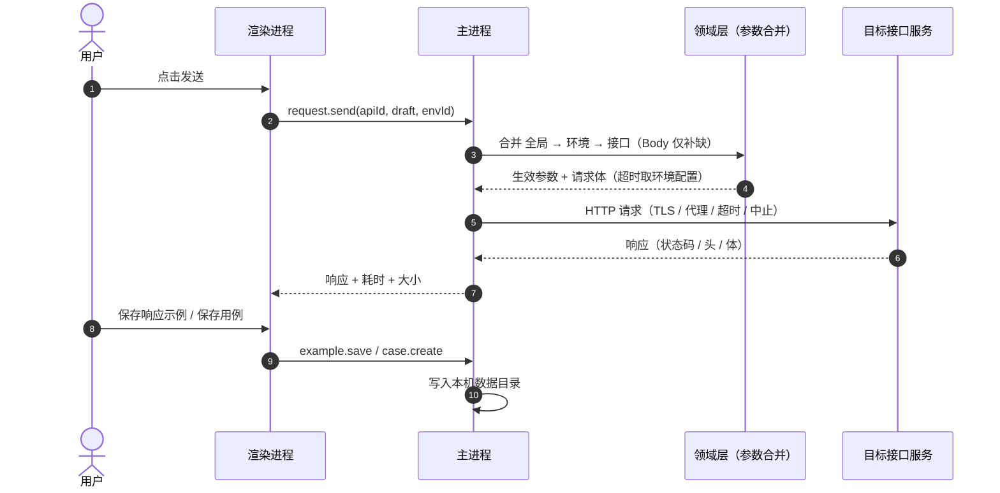
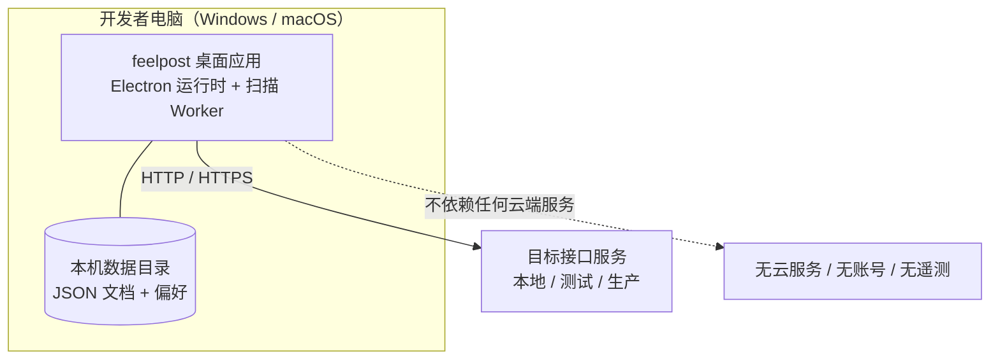
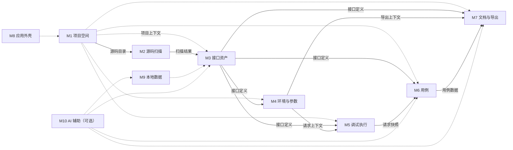

# feelpost 整体架构设计（设计阶段 02）

> **当前实现状态（2026-11-25）**：本文是设计过程记录，部分内容已随实现演进。AI 接入文档 / `aiDoc:*` 已下线，扫描已 Worker 化，品牌统一为 FeelPost。当前实现以 [`docs/实现现状-2026-11-25.md`](../实现现状-2026-11-25.md) 为准。


| 项 | 内容 |
|---|---|
| 文档版本 | v0.4（草案，待评审；TQ1–TQ7 全部确认；AI 可选扩展） |
| 日期 | 2026-11-24 |
| 依据 | ① `docs/design/01.功能模块梳理.md`（v0.6，含 DQ1–DQ19 与 AI 扩展结论）；② `docs/需求基线-v1.md`（v1.1）；③ `prototype/` 原型；④ `docs/rules/database-rules.md`（为后续数据模型阶段预留约束）；⑤ `06.AI模块详细设计.md` |
| 已确认 | TQ1–TQ7（2026-11-19），见 §7.0；AI 可选扩展（2026-11-24），见 §4.3 |
| 本文档范围 | 技术选型、整体架构、模块架构、项目目录、关键决策、待确认问题与风险 |
| 明确不在本文档范围 | 表结构/文件 schema、IPC 详细契约、HTTP 接口定义、页面视觉稿、业务代码 |

> 标注 **「建议·待确认」** 的内容是本文档提出的方案，不视为既定事实；确认后再进入下一阶段。

---

## 1. 设计目标与约束

### 1.1 从功能模块继承的约束

| 约束 | 来源 | 对架构的要求 |
|---|---|---|
| 离线可用为硬底线 | 基线 §1.3 | 核心功能不引入在线依赖；字体、图标、解析器、文档全部内置；不做启动联网校验。AI 为可选扩展，用户配置并主动触发才联网 |
| 单机单用户、无服务端 | Q4 | 不引入账号、权限、远程服务；无多端同步 |
| 数据存本机、接口文档为 JSON | Q17 / FR-T1 | 本地文件为唯一事实来源；数据目录可整体迁移 |
| Windows + macOS | Q16 | 双平台打包与验收 |
| 单项目 ≤1000 接口 | Q19 | 列表虚拟滚动、扫描离主线程、响应体大小限制 |
| 扫描仅 Spring Boot 注解式 | Q2a | 扫描器可针对 Spring 语义做深，而非通用语言解析 |
| 手动扫描、无常驻监听 | Q2b | 不引入文件监听服务 |
| 无断言、无自动回归 | Q10 | 不引入测试执行引擎、报告服务 |
| AI 为可选扩展 | AI 需求确认（2026-11-24） | 核心链路不依赖 AI；新增可选的 OpenAI-compatible 调用链路，见 `06.AI模块详细设计.md` |
| 凭据明文 | Q17 | 接受风险，需在存储层做文件权限与日志脱敏 |

### 1.2 本文档的架构原则

1. **单进程外壳 + 隔离的重活**：UI 与业务在同一桌面应用内完成，扫描放到独立 Worker 线程，避免阻塞与崩溃扩散。
2. **业务规则集中在纯领域层**：参数合并、指纹、状态机、md/curl 生成不依赖 Electron / React，可单测、可复用。
3. **主进程是唯一的数据与网络出口**：渲染进程不发请求、不碰文件系统，降低安全面。
4. **存储可替换**：先以满足需求的 JSON 文件落地，以接口隔离为未来 SQLite 留位。
5. **不为 v1 引入不必要的分布式组件**：没有服务端、没有消息队列、没有 Redis。
6. **扫描器可替换**：解析实现藏在 `ScanEngine` 适配器后，准确率不达标时可换实现而不动上层。

---

## 2. 技术选型

### 2.1 选型总表

| 领域 | 选型（建议） | 备选 | 选型依据 |
|---|---|---|---|
| 桌面容器 | **Electron（当前稳定版）** | Tauri 2 | 复用 Web 技术栈与原型；主进程具备 Node 的文件、网络、子进程能力；Windows/macOS 打包成熟 |
| 前端框架 | **React 18 + TypeScript 5** | Vue 3 / Svelte | 生态与类型支持完善；组件化匹配原型的信息密度；与 Electron 工具链成熟 |
| 构建工具 | **Vite + electron-vite** | Webpack | 主进程 / 预加载 / 渲染进程统一构建，HMR 快 |
| UI 组件 | **自研设计系统 + Radix UI 无头组件** | Ant Design / MUI | 原型是 Postman/Apifox 型高密度界面；无头组件只给无障碍与交互，不被组件库风格绑定 |
| 代码编辑 | **CodeMirror 6** | Monaco | 体积小、离线、JSON/HTTP 高亮够用；Monaco 对本项目过重 |
| 前端状态 | **Zustand** | Redux Toolkit | 无服务端缓存需求，状态简单；避免样板代码 |
| Markdown 渲染 | **markdown-it（内置）** | remark | 离线、轻量；仅用于预览 |
| 扫描引擎 | **web-tree-sitter（WASM）+ 项目符号索引** | JavaParser 子进程 | v1 交付快、包体小、单一运行时；封装在 ScanEngine 后可替换（TQ1-C） |
| 扫描执行 | **Node worker_threads + WASM** | 独立 JVM 进程 | 不阻塞 UI、可终止；无需额外运行时 |
| HTTP 引擎 | **undici（主进程）** | Node http / axios | 原生 fetch 实现；可自定义 Agent 做 TLS 跳过与代理；支持流式响应、中止、任意方法（含 PATCH）、按环境超时 |
| 本地存储 | **JSON 文件（默认 `~/Documents/feelpost`，可改）** | SQLite | 需求要求本地 JSON；可读、可迁移、无原生依赖；支持整目录拷贝/备份（DQ16/TQ7） |
| 缓存 | **进程内内存索引** | Redis / SQLite 缓存 | 单机单用户，无跨进程缓存需求；不引入外部缓存组件 |
| 进程通信 | **contextBridge + 类型化 IPC + zod 校验** | 直接暴露 ipcRenderer | 安全与契约校验；渲染进程最小权限 |
| 打包 | **electron-builder** | electron-forge | 双平台安装包、资源内置、签名配置成熟 |
| 自动更新 | **不做**（安装包手动升级，P2-8） | electron-updater | 离线环境无法做在线更新检查 |
| 日志 | **electron-log（本地轮转，默认脱敏）** | winston | 简单、主/渲染通用；默认不记录请求/响应体（TQ5-A） |
| 测试 | **Vitest + Playwright + JUnit** | Jest | 领域层单测、Electron E2E、扫描器夹具测试分层清晰 |
| 代码规范 | ESLint + Prettier + TypeScript strict | — | 双人以上协作与长期维护的最低成本 |

### 2.2 分项说明

#### 2.2.1 桌面容器：Electron（已确认：TQ2-A）

- **为什么**：项目是"本地接口工具 + 富交互界面"，Electron 的 Web 渲染能直接承接原型；主进程提供 Node 生态（文件、Worker、HTTP、剪贴板、系统对话框），正好覆盖"扫描 Worker + 本地存储 + 请求代理 + 导出文件"四件事。
- **为什么不选 Tauri**：Tauri 产物更小、内存更省，但需要 Rust 侧实现 HTTP（TLS/代理/流式）、文件与子进程管理；本项目扫描器已封装为可替换的 ScanEngine，再引一门 Rust 会提高交付与维护成本。若后续对安装包体积有硬性要求，可重评。
- **代价**：安装包较大（估算 90–120MB，含 Electron 与内置资源）；若后续切换 Java 解析器再增加约 45–60MB（见 TQ1）。

#### 2.2.2 扫描引擎：WASM 优先，保留替换位（已确认：TQ1-C）

- **v1 实现**：`web-tree-sitter` + Java grammar（WASM）运行在 Node `worker_threads` 中；主进程侧维护项目级符号索引（imports、类注册表、继承链、Lombok 注解启发式），用于解析 DTO 类型、嵌套字段与泛型。
- **为什么先不上 JavaParser**：v1 优先交付速度与包体，不引入额外 JRE，双平台构建更简单；扫描实现被封装在 `ScanEngine` 之后，上层模块不感知解析方式。
- **准确率兜底**：每个接口标记"完整 / 部分 / 失败"；解析不完整的字段进入人工层修正（DQ2）；用夹具工程（多模块、Lombok、泛型、继承、常量拼接路径）做回归。
- **替换触发条件**：真实项目解析完整率不达预期，或复杂类型场景频繁出错时，切换为 JavaParser 子进程；接口候选 JSON 的格式保持不变，M3 及以上模块无需改动。
- **范围与排除**：扫描输入包含“范围选择 + 默认排除集合（`target` / `build` / `node_modules` / `.git`）+ 项目自定义排除规则”（DQ17）；支持 GET/POST/PUT/PATCH/DELETE（PATCH 见 DQ12，HEAD 后置）。
- **代价**：没有类型系统解析，复杂 DTO、继承字段、常量路径的准确率依赖启发式，该风险单列于 §8 R1。
- **已确认**：TQ1 选 C —— 先以 WASM 交付，保留 JavaParser 子进程作为替换路径。

#### 2.2.3 存储：JSON 文件优先（已确认：TQ3-A）

- **为什么不用关系库**：需求把"接口文档为本地 JSON"写成硬要求；单项目 ≤1000 接口、单用户，读放大远大于写；JSON 可直接查看、diff、备份、迁移，符合"数据目录可整体拷贝"。
- **如何保证一致性**：写入采用"临时文件 + 原子替换"；按项目分目录、按领域分文件；进程内维护索引，启动时加载。
- **何时才引入 SQLite**：接口量级上到万级、或需要复杂检索/事务时。引入时按 `docs/rules/database-rules.md` 设计（snake_case、无物理外键、逻辑关联）。
- **缓存**：不做跨进程/外部缓存。内存中缓存项目索引、扫描快照与解析结果；偏好（主题、最近项目）单独存放。

#### 2.2.4 网络请求：主进程代理

- 渲染进程直接发请求会遇到 CORS、无法跳过证书校验、无法指定代理、无法读本地文件做 multipart 等问题；因此**统一由主进程发送**，渲染进程只拿结果。
- 主进程用 undici 为每个环境构造独立 Agent：`rejectUnauthorized` 由环境的证书开关决定；代理用 `ProxyAgent`；请求支持中止（扫描取消、发送取消）与超时。
- 响应体设体积上限，超出截断并标记；大响应不写进日志。

### 2.3 明确不引入的技术

| 不引入 | 原因 |
|---|---|
| 本地 HTTP 服务（Spring Boot / Express） | 单机单用户无需服务端；端口占用、生命周期与安全面都是额外成本 |
| 数据库（v1） | 见 2.2.3；先用 JSON 文件 |
| Redis / 消息队列 | 单进程单用户，无跨进程通信需求 |
| 微前端 / 微服务 | 规模不匹配 |
| 云同步 / 账号体系 / 埋点 | 与离线硬约束冲突 |
| 自动更新 | 离线环境无法联网检查；手动安装包升级 |
| 专用 AI SDK | 不引入厂商 SDK；可选 AI 走 OpenAI-compatible HTTP + SSE，复用 `undici`，保持主进程统一网络出口 |

---

## 3. 整体架构

### 3.1 分层视图



**各层职责**

| 层 | 职责 | 不负责 |
|---|---|---|
| 渲染进程 | 页面、交互、表单草稿、展示；只持有 UI 状态 | 业务规则、文件读写、网络请求 |
| Preload | 把主进程能力收窄成类型化 API；不暴露 Node | 业务逻辑 |
| 主进程 / 应用服务 | 用例编排：扫描、入库、合并、发请求、导出、持久化 | 具体解析算法（在扫描器） |
| 领域核心 | 纯函数与实体：指纹、参数合并、状态机、导出内容生成 | IO、框架、Electron API |
| 基础设施适配 | JSON 存储、undici、扫描 Worker、日志、偏好 | 业务判断 |
| 扫描 Worker | 只做"源码 → 接口候选 JSON + 进度" | 入库、授权、写业务数据 |

### 3.2 进程与通信

- **渲染进程**：`nodeIntegration=false`、`contextIsolation=true`、`sandbox=true`；只能通过 preload 暴露的 API 调用主进程。
- **Preload**：按模块分组暴露方法（`project.*`、`scan.*`、`catalog.*`、`env.*`、`request.*`、`case.*`、`doc.*`、`settings.*`），禁止透传任意 channel 名。
- **主进程**：所有 IPC 入参用 zod 校验；返回统一结果结构（成功值 / 错误码 / 可展示消息），不把异常对象直接抛给界面。
- **扫描 Worker**：一次扫描一个 `worker_threads` 实例；主进程投递扫描参数，Worker 通过消息推送进度与结果；主进程可随时终止；WASM 解析器与语法随应用打包。
- **不使用**：本地 socket 服务、HTTP 回调、渲染进程直连扫描器。

### 3.3 关键数据流

#### 3.3.1 扫描与授权入库



**要点**：扫描结果不落盘（DQ8）；未授权的候选只存在于本次会话；范围外的快照保持旧值并标记"未比对"（DQ1）。

#### 3.3.2 发送请求



**要点**：环境参数合并只发生在主进程；渲染进程提交的是"本次编辑"的草稿，不自行合并；证书/代理按环境生效（DQ6）。

#### 3.3.3 部署与离线边界



### 3.4 安全设计

| 项 | 措施 |
|---|---|
| 渲染进程权限 | 关闭 Node、开启沙箱与上下文隔离；CSP 禁止外部资源 |
| IPC 边界 | 白名单通道、zod 校验、错误码化；不接受渲染进程传来的任意文件路径写操作 |
| 文件访问 | 只允许访问项目数据目录与用户显式选择的源码目录；写入前做路径规范化与目录校验 |
| 网络 | 只允许用户配置的目标地址；跟随重定向需限制次数；响应体限长 |
| 凭据 | 明文存储（已接受），但文件权限收紧（仅当前用户可读）；日志默认不记录 header/cookie/body |
| 日志 | 默认脱敏：只记路径、状态码、耗时、错误；提供手动调试开关，开启后才记录完整请求（TQ5-A） |
| 扫描 Worker | 只加载内置 WASM 与用户选择的源码目录（只读）；不执行源码；超时终止 |

---

## 4. 模块架构

### 4.1 模块落位

| 模块 | 所在层 | 核心组件 | 对外能力 |
|---|---|---|---|
| M1 项目空间 | 主进程服务 + 渲染页面 | `ProjectService`、项目列表/新建页 | 项目 CRUD、切换项目、项目上下文 |
| M2 源码扫描 | 主进程服务 + 扫描 Worker | `ScanService`、`ScanEngine`（WASM）、符号索引 | 范围选择、进度、变更集、解析完整度 |
| M3 接口资产 | 主进程服务 + 领域核心 | `CatalogService`、状态机/合并规则 | 待确认队列、授权入库、接口树数据、人工层 |
| M4 环境与参数 | 主进程服务 + 领域核心 | `EnvService`、参数合并器 | 环境 CRUD、全局参数、生效参数 |
| M5 调试执行 | 主进程服务 + HTTP 引擎 | `RequestService`、`HttpEngine` | 发送请求、响应展示、curl、响应示例 |
| M6 用例 | 主进程服务 + 领域核心 | `CaseService` | 保存/复制/改名/删除用例、汇总数据 |
| M7 文档导出 | 主进程服务 + 领域核心 | `DocService`、markdown 生成器 | 预览数据、md 文本、导出文件 |
| M8 应用外壳 | 渲染进程 | Shell、导航、主题、全局反馈 | 页面框架、项目/环境切换器 |
| M9 本地数据 | 主进程基础设施 | `StorageGateway`、`PreferenceStore`、`Logger` | 读写 JSON、偏好、日志 |

### 4.2 模块依赖



依赖方向与阶段 1 §5.2 一致，架构上做了三点收敛：

1. **M9 是基础设施，不是业务依赖**：业务服务只依赖 `StorageGateway` 接口，不直接读文件；换存储实现不影响服务。
2. **领域核心不依赖任何模块**：M3/M4/M6/M7 共享"实体与规则"包，避免互相 import 服务。
3. **M2 不写接口资产**：扫描器只产出候选，写入由 M3 在授权后完成，保持"候选 vs 事实"的边界。

### 4.3 AI 可选扩展

- M10 只读取 M3/M6/M7 的契约与示例，不直接修改资产；
- 生成结果经 IPC 返回渲染进程，由用户确认后调用 M3/M6/M7 的应用接口；
- AI Key 只在主进程使用，使用系统安全存储；
- 上下文由 `ContextBuilder` 统一组装和脱敏，默认不发送源码；
- 未配置 AI 时，M10 不参与启动和任何核心流程；
- 详细设计见 `06.AI模块详细设计.md`。

---

## 5. 项目目录设计

```text
feelpost/
├── package.json
├── tsconfig.json                # 严格模式，路径别名
├── electron.vite.config.ts      # 主/预加载/渲染三端构建
├── electron-builder.yml         # 双平台打包配置
├── .eslintrc.cjs / .prettierrc
│
├── src/
│   ├── main/                    # Electron 主进程（应用层 + 基础设施）
│   │   ├── index.ts             # 应用启动、窗口、生命周期
│   │   ├── ipc/                 # 通道注册、校验、错误映射
│   │   ├── services/            # M1–M7 应用服务
│   │   │   ├── project/
│   │   │   ├── scan/
│   │   │   ├── catalog/
│   │   │   ├── environment/
│   │   │   ├── request/
│   │   │   ├── case/
│   │   │   ├── document/
│   │   │   └── ai/             # AI 配置、上下文、生成、AI 文档
│   │   ├── scanner/             # WASM 扫描实现（ScanEngine 适配）
│   │   │   ├── engine.ts
│   │   │   ├── visitor/         # 注解、路径、参数、DTO 解析
│   │   │   └── worker.ts        # worker_threads 入口
│   │   ├── adapters/            # HTTP、存储、日志
│   │   └── bootstrap/           # 初始化、迁移、崩溃处理
│   │
│   ├── preload/                 # contextBridge 暴露的类型化 API
│   │   └── index.ts
│   │
│   ├── renderer/                # React 界面
│   │   ├── index.html
│   │   └── src/
│   │       ├── app/             # 路由、外壳、主题、全局快捷键
│   │       ├── pages/           # 项目 / 接口 / 用例 / 文档 / 环境
│   │       ├── components/      # 设计系统 + 业务组件
│   │       ├── stores/          # Zustand UI 状态
│   │       └── styles/          # 设计令牌、明暗主题
│   │
│   ├── core/                    # 纯领域层（禁止依赖 Electron / React）
│   │   ├── entities/            # 接口、环境、用例、快照等类型
│   │   ├── rules/               # 合并、指纹、状态机、导出规则
│   │   └── text/                # curl、markdown 生成
│   │
│   └── shared/                  # 主/预加载/渲染共享：IPC 类型、常量、错误码
│
├── resources/                   # 打包资源：图标、WASM grammar（java.wasm）
├── tests/
│   ├── unit/                    # 领域规则与服务单测
│   ├── e2e/                     # Playwright 端到端
│   └── fixtures/                # 示例 Spring 工程（单模块/多模块/Lombok/泛型）
├── scripts/                     # 生成图标、校验 grammar、打包与资源同步脚本
├── docs/                        # 需求与设计文档（现有）
└── prototype/                   # 页面原型（现有，作为 UI 参考）
```

**约定**

- `src/core` 只允许依赖 `src/shared` 与标准库，禁止 import Electron / React / Node 文件系统，保证可测与可复用。
- `src/renderer` 不直接 import `src/main` 或 `src/core`；所有业务数据通过 preload API 获取，规则计算在主进程完成。
- 扫描器以 WASM 形式内置（`resources/grammars/java.wasm`）；若切换 JavaParser，新增独立 `scanner-java/` 工程并保持 `ScanEngine` 接口与中间结果格式不变。
- `resources/` 中只放构建产物与静态资源，不放业务数据；用户数据在独立数据目录。

---

## 6. 关键设计决策

| 编号 | 决策 | 依据 | 影响/代价 |
|---|---|---|---|
| D1 | Electron 作为桌面容器 | 复用 Web 与原型；Node 主进程覆盖网络/文件/子进程 | 安装包较大；需双平台 UI 回归 |
| D2 | 扫描器 v1 用 WASM + 启发式，保留 JavaParser 替换位（TQ1-C） | 交付速度与包体；准确率不达标可切换 | 复杂类型解析精度受限；替换需保持中间结果格式稳定 |
| D3 | 主进程代理所有 HTTP，并支持按环境 TLS/代理 | 渲染进程受 CORS/证书/代理限制；安全边界清晰 | 所有请求能力需在主进程实现 |
| D4 | 领域核心独立为纯 TS 包 | 合并/指纹/状态机/导出规则需单测且被多处复用 | 需要严格约束依赖方向 |
| D5 | 存储先用 JSON 文件，不引入数据库 | 需求要求 JSON；规模小；可读可迁移 | 写入一致性靠原子替换；复杂检索能力有限 |
| D6 | 扫描结果不落盘（DQ8） | 用户取消即丢弃；减少中间状态 | 重新扫描成本；大项目扫描需足够快 |
| D7 | IPC 类型化 + zod 校验 + 错误码化 | 渲染进程不可信；错误需可展示 | 需维护共享类型与错误码 |
| D8 | 不引入本地服务端 | 单机单用户；避免端口与生命周期问题 | 所有能力集中在 Electron 主进程 |
| D9 | 不做自动更新与遥测 | 离线硬约束 | 升级靠安装包分发 |
| D10 | 扫描器与业务解耦（ScanEngine 接口） | 准确率不达标时可替换实现 | 需定义稳定的中间结果格式 |
| D11 | 数据目录默认 `~/Documents/feelpost`，允许更换 | 用户可见、易备份；与 DQ16 整目录迁移一致 | 更换目录需处理旧数据迁移与最近项目路径失效 |

---

## 7. 待确认问题

> 以下均会影响实现路径或交付形态，按优先级排列；未确认前按"建议"执行。

### 7.0 已确认结论（2026-11-19）

| 编号 | 问题 | 结论 | 对架构的影响 |
|---|---|---|---|
| TQ1 | 扫描器形态 | **C. 先 WASM，后替换** | v1 用 web-tree-sitter（WASM）+ 符号索引跑在 worker_threads；保留 JavaParser 替换位；安装包估算 90–120MB |
| TQ2 | 桌面容器 | **A. Electron** | 主进程承担文件、网络、Worker 管理；不引入 Rust |
| TQ3 | 本地存储 | **A. JSON 文件 + 内存索引** | 不引入 SQLite；原子替换写入；数据目录可迁移 |
| TQ4 | UI 组件 | **A. 自研设计系统 + Radix** | 组件与设计令牌自维护；不引入重组件库 |
| TQ5 | 日志边界 | **A. 默认脱敏 + 手动调试开关** | 默认不记录 header/cookie/body；开关开启后写完整请求 |
| TQ6 | macOS 分发 | **A. 无账号，v1 未签名内部使用** | 不做签名/公证；对外分发前需重新评估 |
| TQ7 | 数据目录默认位置 | **A. `~/Documents/feelpost`** | 用户可见、可整目录备份；设置中可改，默认值写入偏好 |

> 架构阶段的 7 个待确认项已全部关闭；需求侧 P2 见需求基线 v1.2。

### TQ1 扫描器形态：WASM 优先，可替换（已确认：C）

- **选项 A（建议）**：Java 17 + JavaParser/JavaSymbolSolver 子进程 + jlink 精简 JRE。
  - 优点：类型解析、继承、泛型、注解、Javadoc 的准确率最高；扫描逻辑可独立单测。
  - 代价：安装包增加约 45–60MB（JRE + jar）；双平台构建链更复杂。
- **选项 B**：web-tree-sitter + Java grammar（WASM），无 JRE。
  - 优点：包体小、构建简单、单一运行时。
  - 代价：无符号解析，复杂 DTO/继承/常量路径的准确率依赖启发式。
- **结论（2026-11-19）**：选 **C（先 WASM 后替换）**。v1 不引入 JRE；以 `ScanEngine` 稳定中间结果，准确率不达标时再切换 JavaParser。

### TQ2 桌面容器：Electron（已确认：A）

- **选项 A（建议）**：Electron。
- **选项 B**：Tauri 2（Rust 侧实现 HTTP/文件/子进程）。
- **结论（2026-11-19）**：选 **A（Electron）**。

### TQ3 存储：JSON 文件（已确认：A）

- **选项 A（建议）**：JSON 文件 + 内存索引。
- **选项 B**：SQLite 存结构化数据 + JSON 存文档。
- **结论（2026-11-19）**：选 **A（JSON + 内存索引）**，不引入 SQLite。

### TQ4 UI 组件方案（已确认：A）

- **选项 A（建议）**：自研设计系统 + Radix 无头组件 + CodeMirror。
- **选项 B**：Ant Design（快，但风格与体积绑定）。
- **结论（2026-11-19）**：选 **A（自研 + Radix + CodeMirror）**。

### TQ5 日志内容边界（已确认：A）

- **建议**：默认只记录路径、状态码、耗时、错误；**不记录** header/cookie/请求体/响应体。
- **结论（2026-11-19）**：选 **A**，默认脱敏，提供手动调试开关。

### TQ6 macOS 分发（已确认：A）

- **建议**：先出未签名 dmg 供内部使用；如需对外分发，需要 Apple Developer 账号做签名与公证。
- **结论（2026-11-19）**：选 **A**，v1 未签名、内部使用。

### TQ7 数据目录默认位置（已确认：A）

- **结论（2026-11-19）**：选 **A（`~/Documents/feelpost`）**，设置中允许更换；数据目录自包含，支持整目录拷贝（DQ16）。

---

## 8. 风险与缓解

| 编号 | 风险 | 影响 | 缓解 |
|---|---|---|---|
| R1 | WASM 解析准确率不足（动态路径、常量拼接、Lombok、复杂泛型/继承） | 产品核心价值受损 | 夹具工程覆盖典型写法；解析完整度标记 + 人工层修正（DQ2）；达不预期即切换 JavaParser（TQ1-C） |
| R2 | 后续切换 JavaParser 的迁移成本 | 解析实现替换可能牵动构建与打包 | 中间结果格式稳定；`ScanEngine` 接口唯一入口；夹具测试先覆盖再替换 |
| R3 | JSON 存储一致性（并发写、崩溃） | 数据损坏 | 单进程串行写、临时文件 + 原子替换、启动校验、备份 |
| R4 | 业务凭据明文（已接受） | 内控审计风险 | 文件权限收紧、日志脱敏、数据目录迁移时提示含敏感信息；AI API Key 使用 safeStorage |
| R5 | Electron 安全面 | 渲染进程被注入后可触达主进程能力 | 沙箱 + 上下文隔离 + IPC 白名单 + 校验 + CSP |
| R6 | 双平台差异（路径、字体、窗口、签名） | 验收遗漏 | 分平台验收清单；CI 双平台冒烟 |
| R7 | 大响应体占内存/磁盘 | 卡顿、数据膨胀 | 响应体限长、示例单独存储、超限截断并提示 |
| R8 | tree-sitter 语法与 Java 版本演进不匹配 | 新语法解析失败 | grammar 随应用升级；失败降级标记；夹具覆盖 |
| R9 | AI 上下文包含业务敏感信息 | 数据出网风险 | 默认不发送源码；自动脱敏 Header/Cookie/Token；首次与上下文变化时强制预览 |
| R10 | AI 输出不稳定或编造字段 | 资产被污染 | 结构化 JSON + zod + 字段路径校验；先预览后应用；不自动写入 |
| R11 | API Key 泄露 | 账号与费用风险 | 主进程 safeStorage、渲染进程不接触、日志与导出禁止包含 |
| R9 | 离线安装包分发与升级 | 用户停留在旧版本 | 安装包手动升级说明；数据格式向后兼容 + 迁移脚本 |

---

## 9. 与阶段 1 模块的覆盖核对

| 阶段 1 模块 | 架构落点 | 是否覆盖 |
|---|---|---|
| M1 项目空间 | `ProjectService` + 项目页 | 是 |
| M2 源码扫描 | `ScanService` + `ScanEngine`（WASM）+ 符号索引 | 是（TQ1-C：WASM 优先，可替换） |
| M3 接口资产与生命周期 | `CatalogService` + 领域规则 | 是 |
| M4 环境与参数 | `EnvService` + 参数合并器 | 是 |
| M5 调试执行 | `RequestService` + `HttpEngine` | 是 |
| M6 用例 | `CaseService` | 是 |
| M7 文档与导出 | `DocService` + 文本生成 | 是 |
| M8 应用外壳 | 渲染进程 Shell / 导航 / 主题 | 是 |
| M9 本地数据与偏好 | `StorageGateway` / `PreferenceStore` / `Logger` | 是 |

未覆盖或需下一阶段细化：数据实体字段与文件 schema、IPC 方法签名与返回结构、扫描器中间结果格式、md 生成模板细节、双平台验收清单。

---

## 10. 变更记录

| 版本 | 日期 | 变更 |
|---|---|---|
| v0.1 | 2026-11-19 | 初稿：技术选型、分层与进程架构、模块落位、目录设计、10 项决策、7 个待确认问题、9 项风险 |
| v0.2 | 2026-11-19 | 确认 TQ1–TQ6：扫描器改为 WASM 优先（可替换）、Electron、JSON 存储、自研 UI、日志脱敏、未签名 macOS；同步更新架构与目录 |
| v0.3 | 2026-11-19 | 确认 TQ7（默认数据目录）；补充 PATCH、按环境超时、Body 仅补缺、默认排除规则、数据目录迁移 |
