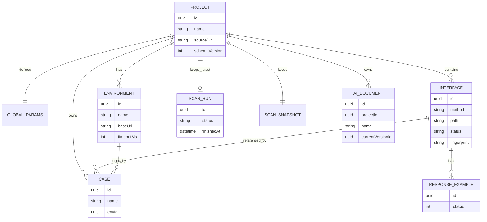
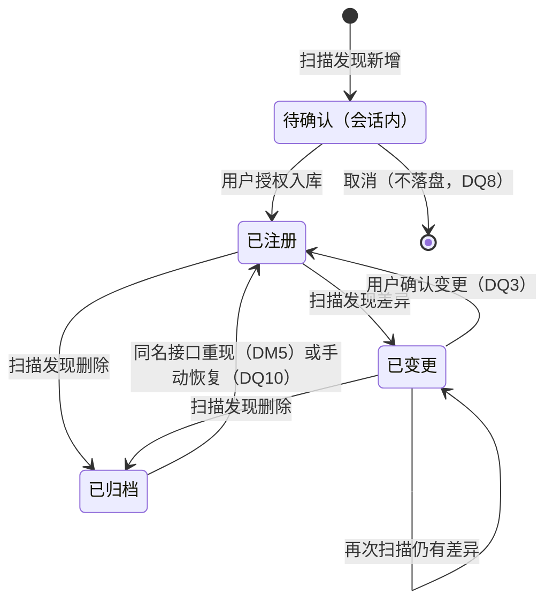

# feelpost 数据模型设计（设计阶段 03）

> **当前实现状态（2026-11-25）**：本文是设计过程记录，部分内容已随实现演进。AI 接入文档 / `aiDoc:*` 已下线，扫描已 Worker 化，品牌统一为 FeelPost。当前实现以 [`docs/实现现状-2026-11-25.md`](../实现现状-2026-11-25.md) 为准。


| 项 | 内容 |
|---|---|
| 文档版本 | v0.2（草案，待评审；AI 扩展实体已纳入） |
| 日期 | 2026-11-24 |
| 依据 | ① `docs/design/01.功能模块梳理.md`（v0.6）；② `docs/design/02.整体架构设计.md`（v0.4）；③ `docs/需求基线-v1.md`（v1.2）；④ `docs/rules/database-rules.md`；⑤ `06.AI模块详细设计.md` |
| 本文档范围 | 逻辑实体、属性语义、实体关系、唯一性与生命周期约束、本地文件划分、状态模型 |
| 明确不在本文档范围 | 物理表结构、JSON Schema 细节、IPC/HTTP 接口契约、索引与查询实现、界面稿 |

> 说明：v1 不使用关系数据库，数据以 JSON 文件落地。本文档仍按 `database-rules.md` 的原则建模：状态取值有限且明确、关联用逻辑字段、时间字段语义清晰、名称表达业务含义。若未来引入 SQLite，再按规则映射为 snake_case 表结构。

---

## 1. 建模目标与边界

### 1.1 要解决的问题

把阶段 1 的 9 个模块、阶段 2 的"JSON 文件 + 主进程服务"架构，落成一组**可持久化的实体与关系**，并明确：

1. 每个实体存什么、谁拥有它、何时创建/变更/消失；
2. 实体之间的引用与删除语义；
3. 哪些规则必须由数据模型保证（唯一性、状态机、覆盖优先级、快照不可变）；
4. 数据在本地目录里如何划分，保证"可迁移、可备份、局部写入不毁全量"。

### 1.2 建模原则

| 编号 | 原则 | 依据 |
|---|---|---|
| P1 | **项目是聚合根**：接口、环境、用例、快照、扫描记录都归属项目，项目删除即整体删除 | M1 / FR-R5 |
| P2 | **记录 ID 与业务身份分离**：记录用 UUID，业务身份是"方法 + 完整路径" | DM1 / BR-1 |
| P3 | **源码层与人工层分离**：扫描只写源码层，人工修正按字段覆盖，指纹只算源码层 | BR-3 / DQ2 / DM3 |
| P4 | **用例是冻结快照**：保存后不随接口定义变化，只保留引用与提示 | BR-6 / DQ5 |
| P5 | **环境是项目内的请求上下文**：URL + 参数 + 凭据 + 网络选项，环境覆盖全局 | DQ6 / Q9 |
| P6 | **全局参数作用域为项目** | DM6 |
| P7 | **扫描结果不持久化，只留最近一次扫描摘要；快照持久化** | DM4 / DQ1 / DQ8 |
| P8 | **归档不物理删除**：接口只归档；用例/环境可删；项目删除需二次确认并级联 | DQ10 / DQ11 |
| P9 | **时间统一 UTC 存储，展示本地化**；创建/更新时间成对出现 | database-rules §3.5 |
| P10 | **状态字段取值有限且集中定义**；派生状态（如"新增"角标）不落库 | database-rules §3.6 |
| P11 | **文件按实体拆分 + 原子替换写入** | DM2 / 架构 §2.2.3 |
| P12 | **不建物理外键**：引用用 id，完整性由应用层校验 | database-rules §4.2 |

### 1.3 与"接口文档为 JSON"的关系

需求要求"接口文档以本地 JSON 存储"。本模型的处理方式：

- **接口实体本身就是文档载体**：源码层 + 人工层合并后即为接口文档；
- **不额外保存一份"文档副本"**，避免双写与不一致；
- 导出 md 是"读取合并视图后的投影"，不产生新的持久化实体。

> 这是 DM7 决策，见 §9。

---

## 2. 实体总览

| 实体 | 说明 | 归属 | 生命周期 |
|---|---|---|---|
| **Project** | 项目元信息与源码目录 | 聚合根 | 创建 → 编辑/换目录 → 删除（级联） |
| **GlobalParams** | 项目级全局请求参数 | Project | 随项目创建，可编辑 |
| **Environment** | 一套请求上下文（URL/参数/凭据/网络） | Project | 创建 → 编辑 → 删除（项目内至少保留 1 个） |
| **Interface** | 接口资产（源码层 + 人工层 + 状态） | Project | 待确认（会话内）→ 已注册 → 已变更 → 已归档；可恢复 |
| **ParamField** | 参数/字段（值对象，嵌入 Interface） | Interface | 随接口定义更新；人工覆盖独立存放 |
| **BodyDefinition** | 请求体定义（值对象，嵌入 Interface） | Interface | 同上 |
| **ResponseExample** | 已保存的响应示例 | Interface | 保存 → 查看 → 删除 |
| **Case** | 冻结的请求快照 + 元信息 | Project / Interface | 创建 → 改名/复制/改标签 → 删除（物理） |
| **ScanRun** | 最近一次扫描的摘要 | Project | 每次扫描覆盖上一条 |
| **ScanSnapshot** | 接口指纹与快照状态 | Project | 扫描后更新；用于增量比对 |
| **Preferences** | 应用级偏好（主题、最近项目等） | 应用 | 持续更新 |
| **AIConfig** | AI 开关、Base URL、模型、超时（值对象，嵌入 Preferences） | 应用 | 随设置更新；API Key 单独安全存储 |
| **AIMeta** | AI 来源、模型、Prompt 版本、时间、token 用量（值对象） | 字段说明 / 用例 / AI 文档 | 应用 AI 结果时写入 |
| **AIDocument** | AI 前端接入文档及其版本 | Project | 创建 → 新版本 → 删除（随项目级联） |

---

## 3. 实体定义

### 3.1 Project（项目）

| 属性 | 语义 | 逻辑类型 | 必填 | 约束/说明 |
|---|---|---|---|---|
| id | 项目 ID | UUID | 是 | 主键 |
| name | 项目名称 | 文本 | 是 | 项目内不要求唯一，界面可重名 |
| sourceDir | 源码根目录 | 路径文本 | 是 | 必须存在且可读；更换后触发"目录已变更"标记 |
| description | 描述 | 文本 | 否 | |
| excludePatterns | 自定义排除规则 | 文本数组 | 否 | 叠加在默认排除集合（`target`/`build`/`node_modules`/`.git`）之上 |
| schemaVersion | 数据版本 | 整数 | 是 | 用于文件迁移 |
| createdAt / updatedAt | 创建/更新时间 | 时间（UTC） | 是 | |
| lastScanAt | 最近扫描时间 | 时间（UTC） | 否 | 与 ScanRun 冗余但便于列表展示 |
| aiHandoffDocumentId | 插入项目文档的 AI 接入文档 | UUID 引用 | 否 | 同一项目最多一个；删除文档时清空 |

**约束**
- 删除项目 = 级联删除其下接口、环境、用例、示例、扫描记录与快照；必须二次确认（DQ11）。
- 更换 sourceDir：保留全部既有接口，并给每条接口打"目录已变更"标记，等待下次扫描比对（DQ19）。

### 3.2 GlobalParams（项目级全局参数）

| 属性 | 语义 | 逻辑类型 | 必填 | 说明 |
|---|---|---|---|---|
| projectId | 所属项目 | UUID 引用 | 是 | 与 Project 一对一 |
| headers / query / cookies / body | 四类参数行 | 参数行数组 | 否 | 行内包含 key、value、enabled |
| updatedAt | 更新时间 | 时间（UTC） | 是 | |

**约束**
- 作用域为项目（DM6）；不同项目互不影响。
- 合并优先级：环境 > 全局（BR-5）；Body 仅补缺、不覆盖接口已有字段（DQ14）。

### 3.3 Environment（环境）

| 属性 | 语义 | 逻辑类型 | 必填 | 说明 |
|---|---|---|---|---|
| id | 环境 ID | UUID | 是 | |
| projectId | 所属项目 | UUID 引用 | 是 | |
| name | 环境名（本地/测试/生产…） | 文本 | 是 | 项目内建议唯一，便于识别 |
| baseUrl | 前置 URL | 文本 | 是 | 需可解析为 http/https |
| params | 环境级参数行 | 四类参数行数组 | 否 | header/query/cookie/body |
| verifyTls | 是否校验 HTTPS 证书 | 布尔 | 是 | 默认 true |
| proxy | HTTP 代理 | 文本 | 否 | 空表示直连 |
| noProxy | 免代理名单 | 文本数组 | 否 | 命中则不走代理 |
| timeoutMs | 请求超时（毫秒） | 整数 | 是 | 默认 30000；按环境覆盖（DQ13） |
| isDefault | 是否项目默认环境 | 布尔 | 是 | 每个项目恰有一个默认 |
| createdAt / updatedAt | 时间 | 时间（UTC） | 是 | |

**约束**
- 每个项目至少保留 1 个环境；删除最后一个环境必须被阻止。
- 删除环境不影响接口清单；用例保留环境快照（见 Case），不会因环境删除而无法展示。
- 切换环境只改变请求上下文，不修改接口与用例（BR-7）。

### 3.4 Interface（接口）

| 属性 | 语义 | 逻辑类型 | 必填 | 说明 |
|---|---|---|---|---|
| id | 接口记录 ID | UUID | 是 | 主键 |
| projectId | 所属项目 | UUID 引用 | 是 | |
| method | HTTP 方法 | 枚举 | 是 | GET / POST / PUT / PATCH / DELETE |
| path | 完整路径 | 文本 | 是 | 已拼接 context-path 与类级路径 |
| name | 接口名称 | 文本 | 是 | 扫描取自方法名/注解，可人工覆盖 |
| summary | 说明 | 文本 | 否 | Javadoc 或人工补充 |
| module | Maven 模块 | 文本 | 否 | 手工接口为空（DQ4） |
| packageName | 包名 | 文本 | 否 | 用于接口树分组 |
| controller | 所属 Controller | 文本 | 否 | 手工接口为空 |
| source | 来源 | 枚举 | 是 | scan / manual |
| status | 状态 | 枚举 | 是 | registered / changed / archived（pending 不持久化，见 §7） |
| parseQuality | 解析完整度 | 枚举 | 是 | full / partial / failed |
| fingerprint | 源码层指纹 | 文本 | 是 | 方法 + 路径 + 参数摘要（BR-2） |
| sourceLayer | 源码层定义 | 对象 | 是 | 参数、请求体、解析时间、解析器版本 |
| manualLayer | 人工层定义 | 对象 | 否 | 字段级覆盖、补充说明（DM3） |
| changeNote | 变更说明 | 文本 | 否 | 最近一次变更的差异摘要 |
| flags | 标记位 | 对象 | 否 | `dirChanged`（目录已变更，DQ19） |
| firstRegisteredAt | 首次入库时间 | 时间（UTC） | 是 | |
| updatedAt | 最近更新时间 | 时间（UTC） | 是 | |

**约束**
- `(projectId, method, path)` 在项目内唯一（包含已归档记录）；归档接口重新出现时复用原记录（DM5）。
- 手工接口 `source=manual`，`module/packageName` 为空，树中归入"手工接口"根级分组（DQ4），不参与扫描比对。
- 指纹只由源码层计算；人工层修改不改变指纹（DQ2）。
- 状态为 `archived` 时不可发送请求，但文档与用例仍可查阅（DQ10）。
- 不提供物理删除接口（DQ10）。

#### 3.4.1 源码层结构（SourceLayer）

| 属性 | 语义 | 说明 |
|---|---|---|
| params | 四类参数集合（path/query/header/cookie） | 每项为 ParamField |
| body | 请求体定义 | BodyDefinition |
| parsedAt | 解析时间 | UTC |
| parserVersion | 解析器版本 | 用于追溯解析差异 |
| issues | 解析问题列表 | 部分解析/失败原因 |

#### 3.4.2 人工层结构（ManualLayer）

| 属性 | 语义 | 说明 |
|---|---|---|
| overrides | 字段级覆盖 | 以"参数位置 + 字段路径"定位，覆盖名称/类型/必填/默认值/说明 |
| summary | 接口补充说明 | 覆盖源码层 summary |
| updatedAt | 更新时间 | UTC |

> 字段级覆盖（DM3）而不是整接口覆盖：扫描更新后只保留被人工修过的字段，其余继续跟随源码。

### 3.5 ParamField（参数/字段，值对象）

| 属性 | 语义 | 说明 |
|---|---|---|
| location | 位置 | path / query / header / cookie / body |
| path | 字段路径 | 支持嵌套，如 `items[].skuId` |
| name | 参数名 | |
| type | 类型 | 如 String / Integer / Array&lt;Object&gt; |
| required | 是否必填 | 来自注解或 Javadoc |
| defaultValue | 默认值 | 可空 |
| description | 说明 | Javadoc 或人工补充 |
| constraints | 约束描述 | 如长度、枚举范围 |
| children | 子字段 | 嵌套对象时使用 |

**约束**
- 同一层内 `location + path` 不重复。
- 数组元素字段沿用 `[]` 约定（如 `items[].quantity`）。

### 3.6 BodyDefinition（请求体，值对象）

| 属性 | 语义 | 说明 |
|---|---|---|
| type | 类型 | json / form / multipart |
| fields | 字段列表 | ParamField（location=body） |
| sample | 示例请求体 | 扫描推断或人工编辑 |
| raw | 原始文本 | 调试页编辑时使用 |

### 3.7 ResponseExample（响应示例）

| 属性 | 语义 | 逻辑类型 | 必填 | 说明 |
|---|---|---|---|---|
| id | 示例 ID | UUID | 是 | |
| apiId | 所属接口 | UUID 引用 | 是 | |
| name | 示例名称 | 文本 | 是 | |
| status | HTTP 状态码 | 整数 | 是 | |
| headers | 响应头 | 键值数组 | 否 | |
| body | 响应体 | 文本 | 否 | 大响应可截断并标记 |
| truncated | 是否被截断 | 布尔 | 否 | |
| sourceCaseId | 来源用例 | UUID 引用 | 否 | FR-D4 要求标注来源 |
| savedAt | 保存时间 | 时间（UTC） | 是 | |
| fieldDescriptionMeta | 字段说明的 AI 元信息 | 对象（fieldPath → AIMeta） | 否 | 仅 AI 应用后出现，见 06 |

**约束**
- 示例属于接口的人工层资产，扫描不得删除（BR-3）。
- 示例可删除；删除不影响接口与用例。

### 3.8 Case（用例）

| 属性 | 语义 | 逻辑类型 | 必填 | 说明 |
|---|---|---|---|---|
| id | 用例 ID | UUID | 是 | |
| projectId | 所属项目 | UUID 引用 | 是 | |
| apiId | 关联接口 | UUID 引用 | 是 | 接口归档后仍保留 |
| name | 用例名 | 文本 | 是 | 可改名（DQ5） |
| tags | 标签 | 文本数组 | 否 | 可编辑 |
| note | 备注 | 文本 | 否 | 可编辑 |
| envId | 保存时环境 | UUID 引用 | 是 | 环境删除后仍保留 id 与快照 |
| requestSnapshot | 冻结请求 | 对象 | 是 | 见下 |
| savedAt / updatedAt | 时间 | 时间（UTC） | 是 | |
| aiMeta | AI 用例元信息 | AIMeta | 否 | 仅 AI 导入后出现；标签含 `AI` |

**requestSnapshot 结构**

| 属性 | 语义 | 说明 |
|---|---|---|
| method / path | 请求方法与路径 | 保存时快照 |
| baseUrl | 保存时前置 URL | 防止环境变更后仍以为指向旧地址 |
| envName | 保存时环境名 | 环境删除后仍可展示 |
| pathParams / query / headers / cookies | 请求参数快照 | 行内 key/value/enabled |
| bodyType / bodyRaw / formRows / files | 请求体快照 | 文件只记录名称与大小，不复制文件内容 |

**约束**
- 请求快照保存后不可编辑；可改的只有元信息（名称/标签/备注）（DQ5）。
- 复制用例 = 新建一条用例，复制请求快照与元信息，生成新 id。
- 用例删除为物理删除（与接口归档不同），删除需确认。
- 接口变更只产生"基于旧定义"的提示，不修改用例内容（BR-6）。

### 3.9 ScanRun（最近一次扫描摘要）

| 属性 | 语义 | 说明 |
|---|---|---|
| id | 扫描记录 ID | UUID |
| projectId | 所属项目 | UUID 引用 |
| scope | 扫描范围 | 类型（整个工程/目录/模块）+ 具体值 |
| startedAt / finishedAt | 起止时间 | UTC |
| status | 结果 | success / cancelled / failed |
| counts | 结果计数 | 新增/变更/删除/解析失败数 |
| uncomparedModules | 未比对模块 | 局部扫描时记录（DQ1） |
| parserVersion | 解析器版本 | |
| error | 失败原因 | 可空 |

**约束**
- 每个项目只保留最近一次（DM4）；新扫描覆盖旧记录。
- 扫描结果本身（候选集）不持久化，只在会话内存在（DQ8）。

### 3.10 ScanSnapshot（扫描快照）

| 属性 | 语义 | 说明 |
|---|---|---|
| projectId | 所属项目 | 与项目一对一 |
| updatedAt | 更新时间 | UTC |
| entries | 身份 → 快照项 | 键为 `method + path` |
| moduleStates | 模块比对状态 | 已比对 / 未比对，供 DQ1 使用 |

**快照项**

| 属性 | 语义 |
|---|---|
| apiId | 已入库接口的 id（未入库为空） |
| fingerprint | 上次解析的源码层指纹 |
| paramsDigest | 参数集合摘要（用于差异说明） |
| module / packageName | 归属，用于范围比对 |
| lastSeenAt | 最近一次在源码中出现的时间 |

**约束**
- 局部扫描只更新所选范围内的 entries 与 moduleStates；范围外保持旧值并标记"未比对"（DQ1）。
- 快照是增量判定依据，不包含人工层信息。

### 3.11 Preferences（应用偏好）

| 属性 | 语义 | 说明 |
|---|---|---|
| theme | 主题 | light / dark（DQ15） |
| lastProjectId | 最近项目 | 启动时定位 |
| lastEnvByProject | 项目 → 最近环境 | 键值映射 |
| dataDir | 数据目录 | 默认 `~/Documents/feelpost`，可改（TQ7） |
| debugLogging | 调试日志开关 | 默认关闭（TQ5） |
| windowState | 窗口尺寸/位置 | 可选 |
| ai | AI 配置 | `AIConfig`；不含 API Key（Key 使用 safeStorage） |

**约束**
- 应用级，不属于任何项目；不随项目删除。
- 不含业务数据；丢失偏好不影响项目数据。

### 3.12 AI 扩展实体（可选）

> 本节只定义与主数据模型的衔接；完整字段、IPC、Prompt 与交互见 `06.AI模块详细设计.md`。

#### AIConfig

| 属性 | 语义 | 逻辑类型 | 必填 | 说明 |
|---|---|---|---|---|
| enabled | 是否启用 AI | 布尔 | 是 | 默认 false |
| baseUrl | OpenAI-compatible 地址 | URL 文本 | 否 | 启用时必填 |
| model | 模型名 | 文本 | 否 | 启用时必填 |
| timeoutMs | 调用超时 | 整数 | 是 | 默认 60000，10s–180s |

- 归属于 `Preferences`；
- API Key 不在 JSON 中，使用 Electron `safeStorage`，键 `feelpost.ai.apiKey`。

#### AIMeta

| 属性 | 语义 | 逻辑类型 | 必填 | 说明 |
|---|---|---|---|---|
| source | 来源 | 枚举 `ai` | 是 | 固定值 |
| provider | 接入协议 | 枚举 `openai-compatible` | 是 | |
| model | 模型名 | 文本 | 是 | |
| promptVersion | Prompt 版本 | 文本 | 是 | 如 `field-notes.v1` |
| generatedAt | 生成时间 | 时间（UTC） | 是 | |
| contextHash | 上下文摘要 | 文本 | 是 | 用于追溯，不保存原始上下文 |
| usage | token 用量 | 对象 | 否 | `promptTokens / completionTokens / totalTokens` |

#### 字段说明与用例扩展

- `RequestDraft.fieldDescriptionMeta: Record<fieldPath, AIMeta>`
- `ResponseExample.fieldDescriptionMeta: Record<fieldPath, AIMeta>`
- `Case.aiMeta: AIMeta`，导入时自动加入 `AI` 标签
- 不保存完整 Prompt、原始响应

#### AIDocument / AIDocumentVersion

| 属性 | 语义 | 说明 |
|---|---|---|
| id / projectId | 文档 ID / 归属项目 | 项目删除级联 |
| name | 文档名 | 默认「项目名 · 前端接入摘要」 |
| interfaceIds | 生成时选中的接口 | 最多 20 个 |
| currentVersionId | 当前版本 | 指向 versions 中的一条 |
| versions | 版本数组 | 最多 10 个，超出删除最旧 |
| createdAt / updatedAt | 时间（UTC） | |

版本字段：`id / createdAt / markdown / typescript / meta`。

**约束**
- 同一项目最多一个 `aiHandoffDocumentId`；
- 项目文档读取该文档最新版本，输出固定「AI 前端接入摘要」章节；
- AI 文档全部为可选资产，缺失不影响基础文档导出。

---

## 4. 实体关系

### 4.1 关系图



### 4.2 关系与删除规则

| 关系 | 基数 | 删除规则 |
|---|---|---|
| Project → Interface | 1 : N | 项目删除级联删除；接口本身不物理删除，只能归档 |
| Project → Environment | 1 : N | 环境删除不级联用例；用例保留 envId 与环境快照 |
| Project → GlobalParams | 1 : 1 | 随项目创建与删除 |
| Project → Case | 1 : N | 随项目删除级联；单条用例可物理删除 |
| Project → ScanRun | 1 : 1（最近一次） | 随项目删除；新扫描覆盖旧记录 |
| Project → ScanSnapshot | 1 : 1 | 随项目删除 |
| Interface → ResponseExample | 1 : N | 接口归档不删除示例；示例可单独删除 |
| Interface → Case | 1 : N | 接口归档不删除用例；用例可单独删除 |
| Environment → Case | 1 : N | 环境删除不删除用例；用例显示保存时的环境快照 |
| Project → AIDocument | 1 : N | 随项目删除级联；`aiHandoffDocumentId` 指向的文档删除时清空指针 |

---

## 5. 唯一性、完整性与一致性

| 编号 | 规则 | 实现约束 |
|---|---|---|
| C1 | 项目内 `method + path` 唯一（含归档） | 写入前校验；归档复活复用原记录（DM5） |
| C2 | 每个项目恰有一个默认环境 | 创建项目时生成；切换默认时同事务更新 |
| C3 | 每个项目至少一个环境 | 删除最后一个环境的操作被拒绝 |
| C4 | 参数行 `location + path` 不重复 | 合并前去重，后者覆盖前者（BR-5） |
| C5 | 用例快照不可变 | 只有元信息字段可更新 |
| C6 | 指纹只取源码层 | 人工层更新不触发 `changed` |
| C7 | 扫描记录每次覆盖 | 只保留最近一次（DM4） |
| C8 | 局部扫描不改范围外快照 | 范围外标记"未比对"（DQ1） |
| C9 | 项目删除为级联硬删除 | 需二次确认；不做回收站（见 §10 Q4） |
| C10 | 引用完整性由应用层维护 | 无物理外键；写入前校验引用存在 |
| C11 | 同一项目最多一个 AI 文档插入指针 | 插入新文档时清空旧指针 |
| C12 | AI 文档版本最多 10 个 | 新版本追加时删除最旧版本，保留当前版本 |

---

## 6. 状态与生命周期

### 6.1 接口状态机



**说明**
- `待确认` 不是持久化状态：扫描候选只在当前会话存在（DQ8），因此不在接口文件里落 `pending`。
- 新增角标、受影响用例提示属于派生展示，不作为持久状态（P10）。
- `dirChanged` 是标记位而非状态，不影响状态机（DQ19）。

### 6.2 其他生命周期

| 实体 | 生命周期 |
|---|---|
| 环境 | 创建 → 编辑 → 删除；默认环境不可直接删除，需先切换默认 |
| 用例 | 创建 → 改名/改标签/复制 → 删除（物理） |
| 响应示例 | 保存 → 查看 → 删除 |
| 扫描记录 | 每次扫描覆盖上一条；项目删除时删除 |
| 快照 | 随扫描更新；项目删除时删除 |
| AI 文档 | 创建 → 追加版本 → 插入项目文档 → 删除（随项目级联；版本最多 10 个） |

---

## 7. 存储划分与写入

### 7.1 逻辑目录

> 具体文件名在实现阶段可微调，这里只定"按实体拆分"的结构（DM2）。

```text
<dataDir>/
├── preferences.json                 # 应用级偏好（主题、最近项目、数据目录…）
└── projects/
    └── <projectId>/
        ├── project.json             # Project 元信息
        ├── globals.json             # GlobalParams
        ├── environments.json        # 环境列表
        ├── interfaces/
        │   └── <interfaceId>.json   # 单个接口（源码层 + 人工层 + 状态）
        ├── examples/
        │   └── <exampleId>.json     # 响应示例
        ├── cases/
        │   └── <caseId>.json        # 用例快照
        ├── ai-docs/
        │   └── <documentId>.json    # AI 接入文档 + 最近 10 版
        └── scan/
            ├── latest-run.json      # ScanRun（只保留最近一次）
            └── snapshot.json        # ScanSnapshot
```

### 7.2 写入约束

| 约束 | 说明 |
|---|---|
| 原子写 | 先写临时文件，再原子替换；避免中途崩溃产生半文件 |
| 单写者 | 单进程串行写；不引入文件锁 |
| 局部写 | 修改一个接口只重写该接口文件，不重写全项目 |
| 启动校验 | 加载时校验 `schemaVersion`、引用存在性、必填字段 |
| 备份 | 整个 dataDir 可直接拷贝/替换（DQ16） |
| 敏感数据 | 业务凭据明文落盘（已接受），文件权限收紧；AI API Key 使用 safeStorage；日志默认不记录请求体（TQ5） |

### 7.3 版本与迁移

- `Project.schemaVersion` 与全局数据版本配合，启动时执行迁移链。
- 迁移只增不改：新增字段给默认值；删除字段先保留一个版本周期（若发生）。
- 迁移失败时进入只读模式并提示备份，不覆盖原数据。

---

## 8. 与模块 / 需求的对应

| 模块 | 使用的实体 | 说明 |
|---|---|---|
| M1 项目空间 | Project | 项目创建/切换/删除 |
| M2 源码扫描 | ScanSnapshot、ScanRun | 扫描只读源码，产出候选；快照用于增量 |
| M3 接口资产 | Interface、ParamField、BodyDefinition、ResponseExample | 授权入库、状态机、人工层、接口树 |
| M4 环境与参数 | Environment、GlobalParams | 环境与全局参数、合并展示 |
| M5 调试执行 | Interface、Environment | 读取定义与环境上下文；不新增实体（调用结果不落盘） |
| M6 用例 | Case | 冻结快照、汇总、复制/改名/删除 |
| M7 文档导出 | Interface、ResponseExample、Case、AIDocument | 基础 md 为投影；可选读取 AI 文档最新版本追加章节 |
| M8 应用外壳 | Preferences | 主题、最近项目 |
| M9 本地数据 | 全部 | 文件划分、原子写、迁移 |
| M10 AI 辅助（可选） | AIConfig、AIMeta、AIDocument | 字段说明/用例元信息、AI 接入文档；未配置不参与 |

| 关键规则 | 数据模型落点 |
|---|---|
| BR-1 接口身份 | `(projectId, method, path)` 唯一（C1） |
| BR-2 指纹 | `Interface.fingerprint` + `ScanSnapshot.entries` |
| BR-3 分层合并 | `sourceLayer` / `manualLayer` 字段级覆盖（DM3） |
| BR-4 授权入库 | `pending` 不落盘，授权后才创建 Interface |
| BR-5 环境覆盖全局 | GlobalParams + Environment.params 合并顺序 |
| BR-6 用例冻结 | `Case.requestSnapshot` 不可变 |
| BR-7 环境隔离 | 环境只被请求上下文引用，不改变 Interface/Case |
| BR-8 解析降级 | `parseQuality` + `sourceLayer.issues` |
| BR-9 基础导出 6 块 | 合并视图投影，无独立文档副本（DM7）；AI 摘要为可选附加章节 |
| BR-10 方法范围 | `Interface.method` 枚举（PATCH 已纳入） |
| BR-11 手动扫描 | 无监听相关实体；ScanRun 手动产生 |
| BR-12 无断言 | 无断言/执行结果实体 |

---

## 9. 关键设计决策

| 编号 | 决策 | 依据 |
|---|---|---|
| DM1 | UUID 主键 + `method + path` 业务身份 | 路径变更不牵连用例/示例；迁移不冲突 |
| DM2 | JSON 按实体拆分（接口/用例逐文件） | 局部写、损坏面小、便于 diff 与备份 |
| DM3 | 人工层字段级覆盖 | 扫描更新后只保留人工修过的字段 |
| DM4 | 只保留最近一次扫描摘要 | 支持"未比对"提示，避免历史膨胀 |
| DM5 | 归档接口重新出现时复用原记录 | 保留用例与示例关联，避免重复记录 |
| DM6 | 全局参数为项目级 | 避免跨项目串用 token |
| DM7 | 接口文档不存副本，合并视图即文档 | 避免双写与不一致 |
| DM8 | 用例保存环境快照（baseUrl/envName） | 环境删除或改 URL 后仍能解释用例 |
| DM9 | 时间 UTC 存储、展示本地化 | 跨平台一致，符合规范 |
| DM10 | "待确认/新增"不落盘，按会话派生 | 与 DQ8、P10 一致 |
| DM11 | AI 文档独立存储，项目文档只保存插入指针 | 支持多版本、避免与基础文档双写 |
| DM12 | AI 元信息嵌入被应用实体，不单独保存原始调用 | 可追溯且减少隐私与体积风险 |

---

## 10. 待确认问题

> 均不阻塞主体建模，可在页面/接口设计前定。

| 编号 | 问题 | 影响 | 建议 |
|---|---|---|---|
| Q1 | 响应示例是否允许编辑（改名称/内容）？ | 示例资产的编辑入口 | 允许改名称与删除，内容不可编辑（重新保存生成新示例） |
| Q2 | 用例删除是否物理删除、不可恢复？ | 数据安全 | 物理删除 + 二次确认（与当前原型一致） |
| Q3 | 环境删除后，用例中的环境快照是否足够？是否需要"环境已删除"提示？ | 用例详情展示 | 显示保存时环境名，并标注"环境已删除" |
| Q4 | 项目删除是否提供回收站/可恢复？ | 误删风险 | v1 不做回收站，删除前提示导出备份 |
| Q5 | 接口树排序规则（模块/包/路径）？ | 展示稳定性 | 模块按名称、包按名称、接口按 path 字典序；手工接口置顶或置底待定 |
| Q6 | 扫描快照是否需要保留"上次解析器版本"以提示结果差异？ | 升级后的解析差异说明 | 保留 `parserVersion`，界面在版本变化时提示 |

---

## 11. 风险与约束提醒

| 风险 | 说明 | 缓解 |
|---|---|---|
| 文件数量 | 每接口/用例一个文件，1000 接口会产生千级小文件 | 可接受；必要时按目录分片（不改变实体） |
| 写入冲突 | 单进程串行写，但崩溃可能留下临时文件 | 启动清理临时文件；原子替换 |
| 快照与实体不一致 | 扫描更新快照但接口未授权时，快照中 apiId 为空 | 授权入库时补写 apiId；未授权记录在下次扫描重新判定 |
| 用例指针失效 | 项目删除会级联删用例 | 删除前强提示；不做跨项目引用 |
| 明文凭据 | dataDir 拷贝即带走凭据 | 导出/迁移时提示；日志脱敏（已确认） |
| 时区展示 | UTC 存储、本地展示可能跨时区 | 统一经时间格式化层输出 |

---

## 12. 变更记录

| 版本 | 日期 | 变更 |
|---|---|---|
| v0.1 | 2026-11-20 | 初稿：11 个实体、关系与删除规则、状态机、10 项建模决策、6 个待确认问题 |
