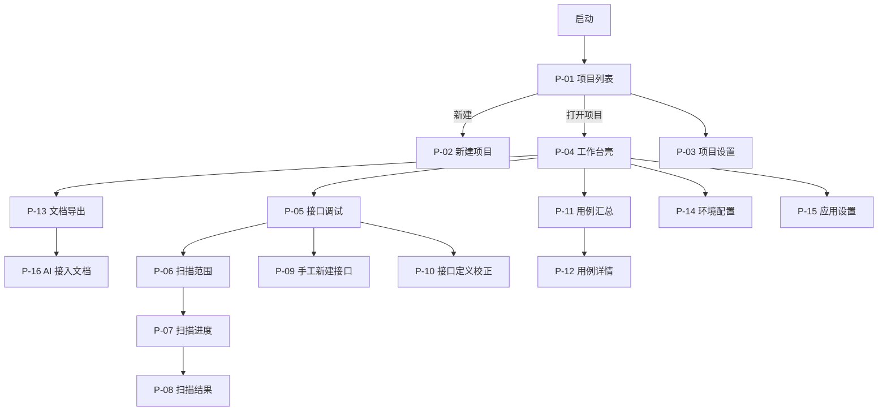
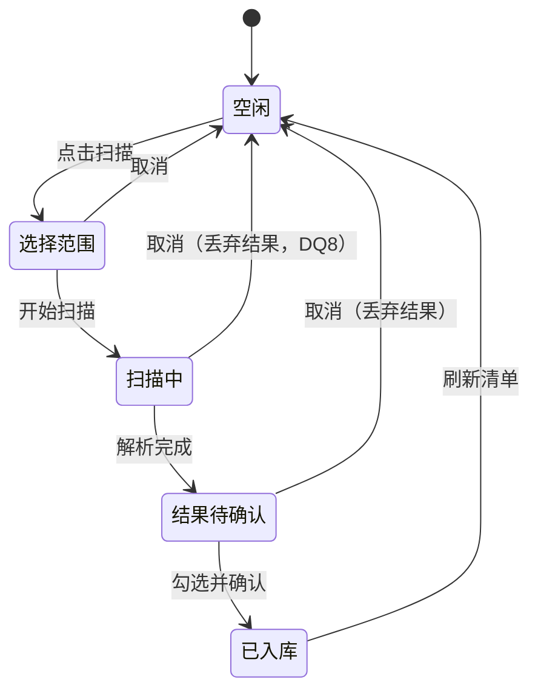

# feelpost 页面与交互设计（设计阶段 04）

> **当前实现状态（2026-11-25）**：本文是设计过程记录，部分内容已随实现演进。AI 接入文档 / `aiDoc:*` 已下线，扫描已 Worker 化，品牌统一为 FeelPost。当前实现以 [`docs/实现现状-2026-11-25.md`](../实现现状-2026-11-25.md) 为准。


| 项 | 内容 |
|---|---|
| 文档版本 | v0.4（UQ1–UQ8 已确认；AI 页面扩展已纳入） |
| 日期 | 2026-11-24 |
| 依据 | ① `docs/design/01.功能模块梳理.md`（v0.6）；② `docs/design/02.整体架构设计.md`（v0.4）；③ `docs/design/03.数据模型设计.md`（v0.2）；④ `prototype/` 可交互原型；⑤ `06.AI模块详细设计.md` |
| 本文档范围 | 信息架构、页面清单、关键页面结构、交互状态、组件与设计令牌、原型对齐清单 |
| 明确不在本文档范围 | 视觉稿（像素级）、组件代码、IPC/API 契约、数据 schema |

> 本文档以原型为基线做"设计化整理 + 补齐已确认决策带来的新交互"；与原型不一致处会集中列在 §9，不静默改动。

---

## 1. 设计原则

1. **高频路径最短**：扫描 → 确认 → 发送 → 保存 → 导出，任何一步不超过一次主操作。
2. **状态始终可见**：接口状态（已注册/已变更/已归档）、解析完整度、来源（扫描/手工）、目录变更、未比对，都有固定位置展示，不藏在悬停里。
3. **危险操作可逆或需确认**：接口只归档不删除；用例/环境/项目删除需二次确认；扫描取消即丢弃（DQ8）也要提示后果。
4. **离线零等待**：不出现加载远程资源、登录、版本检查；所有等待只来自本地扫描与网络请求。
5. **信息密度优先**：这是开发者工具，不做大面积留白；面板可拖拽、可折叠，表格紧凑。
6. **一个主工作区**：项目 → 接口/用例/文档/环境 四个工作区，靠左轨切换，不打开多级弹窗套娃。

---

## 2. 信息架构

### 2.1 站点地图



### 2.2 导航规则

- **应用级**：项目列表 ↔ 工作台。顶栏始终显示当前项目与环境，可直接切换（切项目等于换工作区上下文）。
- **工作台级**：左轨四区（接口 / 用例 / 文档 / 环境），底部为设置与重置（重置仅原型保留，正式版改为"帮助/关于"）。
- **侧栏随区变化**：接口区=模块树；用例区=标签与统计；文档区=导出对象；环境区=环境列表。
- **主区**：每个工作区一个主视图；弹窗只用于"需要专注的短任务"（新建、校正、扫描范围/结果、用例详情）。
- **启动落点**：固定进入项目列表（UQ1），不自动恢复上次项目。
- **返回**：不设多级路由，Esc 关闭弹窗/菜单；项目列表是唯一"离开工作台"的出口。

---

## 3. 页面清单

| 编号 | 页面 / 弹窗 | 入口 | 目标 | 关键区域 | 关键操作 |
|---|---|---|---|---|---|
| P-01 | 项目列表 | 启动 | 选择/管理项目 | 项目卡片（名称、目录、接口/用例/环境数、最近扫描） | 打开、新建、重命名/删除入口、重置（原型） |
| P-02 | 新建项目 | P-01 / 顶栏项目菜单 | 创建项目并接入工程 | 名称、源码目录（选择器/手填）、描述、本地环境 URL | 创建并进入 |
| P-03 | 项目设置 | 顶栏项目菜单 | 维护项目元信息 | 名称、源码目录、描述、排除规则、危险区 | 保存、删除项目 |
| P-04 | 工作台壳 | 打开项目 | 承载四区与全局状态 | 顶栏、左轨、侧栏、主区 | 切项目/环境、扫描、主题、切区 |
| P-05 | 接口调试 | 工作台 | 查看接口、发请求、保存产物 | 接口头、请求区、响应区、示例条 | 发送、保存用例/示例、复制 curl、确认变更、恢复归档、校正字段 |
| P-06 | 扫描范围 | 顶栏扫描 | 选择本次扫描范围 | 整工程 / 指定目录 / 指定模块（模块→包树） | 开始扫描、示例目录、模块整选/半选 |
| P-07 | 扫描进度 | 范围确认后 | 展示解析进度 | 日志、进度条、当前范围 | 取消（丢弃本次结果） |
| P-08 | 扫描结果 | 进度完成 | 授权入库 | 分类摘要、结果列表、勾选、差异说明、未比对提示 | 批量确认、取消 |
| P-09 | 手工新建接口 | 接口侧栏“+” | 纳管源码外接口 | 方法、路径、名称、说明 | 创建 |
| P-10 | 接口定义校正 | 接口头“校正” | 人工层修正解析结果 | 字段列表（源码值/人工值）、说明、来源标记 | 保存修正、撤销单个字段 |
| P-11 | 用例汇总 | 左轨 | 浏览与维护用例 | 统计卡、筛选、用例表 | 查看、改名、复制、删除、导出 md |
| P-12 | 用例详情 | 用例表行 | 查看冻结快照 | 元信息、请求快照、环境快照 | 复制 curl、关闭 |
| P-13 | 文档导出 | 左轨 | 预览与导出 md | 范围/环境/含手工开关、预览、Markdown 源码 | 复制、下载、切换视图 |
| P-14 | 环境配置 | 左轨 / 顶栏环境菜单 | 维护请求上下文 | 环境列表、URL/超时/证书/代理、参数、全局参数、生效预览 | 切换、新建、编辑、删除、设为默认 |
| P-15 | 应用设置 | 左轨底部 | 应用级偏好 | 主题、数据目录、调试日志、备份提示、版本、AI 配置 | 修改、打开数据目录、测试 AI 连接 |
| P-16 | AI 接入文档 | 文档工作区 | 管理与生成 AI 前端接入摘要 | 接口选择、Markdown/TypeScript 预览、版本、插入项目文档 | 生成、保存、复制、导出、插入、查看历史 |

---

## 4. 关键页面结构

### 4.1 P-04 工作台壳

```text
┌────────────────────────────────────────────────────────────────────────────┐
│ {feelpost}  项目 ▾  环境 ▾        上次扫描 11-20 10:20     [扫描]  [☾]     │
├──────┬──────────────────────┬──────────────────────────────────────────────┤
│ 接口 │  搜索 / 方法筛选      │  接口头：方法 路径 名称 · 状态 · 解析 · 来源  │
│ 用例 │  展开全部 / 收起全部  │ ┌ 提示条：变更 / 目录已变更 / 部分解析 / 未比对 │
│ 文档 │  ▸ user-service  6   │ ├────────────────────────────────────────────┤
│ 环境 │  ▾ order-service 4   │ │ 请求区：Params Headers Body Cookies 生效参数 │
│      │    ▾ 订单模块      3  │ │                                      [发送] │
│      │      GET /orders     │ ├──────────── 拖拽分隔 ───────────────────────┤
│      │      POST /orders    │ │ 响应区：状态 / 耗时 / 大小 / 响应体|头|原始   │
│      │  ▸ 手工接口       2   │ │                                            │
│ ⚙    │                      │ └ 响应示例条：示例 chips · 保存示例 ───────────┘
└──────┴──────────────────────┴──────────────────────────────────────────────┘
```

**规则**
- 顶栏常驻：项目切换、环境切换、上次扫描时间、扫描入口、主题。
- 侧栏宽度可拖拽（最小 220，最大 420）；主区请求/响应可上下拖拽（最小高度 160 / 200）。
- 侧栏默认只显示模块；手工接口是根级分组（DQ4），排在模块之后。
- 侧栏搜索与方法筛选同时生效；搜索时保留各层折叠状态（DQ9 的临时筛选也遵守）。
- 排序：模块按名称 → 包按名称 → 接口按 path 字典序；"手工接口"根级分组排在全部模块之后（UQ7）。

### 4.2 P-05 接口调试

**接口头**

- 方法徽标 + 完整路径 + 名称；
- 状态 chip：已注册 / 已变更 / 已归档；
- 解析 chip：完整 / 部分解析 / 失败；
- 来源 chip：扫描 / 手工；
- 操作：校正字段（P-10）、复制 curl、保存用例、发送；`已变更` 时多一个 **确认变更**；`已归档` 时发送禁用、出现 **恢复为已注册**。

**提示条（按优先级从上到下）**

| 提示 | 触发 | 样式 | 操作 |
|---|---|---|---|
| 目录已变更 | 项目换过源码目录（DQ19） | 警告 | 去扫描 |
| 本次扫描检测到变更 | status=changed | 信息 | 确认变更 |
| 部分解析/解析失败 | parseQuality≠full | 警告 | 校正字段 |
| 本次未比对 | 局部扫描的未比对模块（DQ1） | 中性 | 查看扫描范围 |

**请求区**

- 标签：Params（Path + Query）、Headers、Body、Cookies、生效参数。
- Headers 顶部展示自动带入的环境/全局 Header（只读 + 来源标记），下方为接口本地 Header。
- Body 三种类型：JSON（CodeMirror）、表单（键值表）、文件上传（选择文件 + 字段值）。
- 生效参数：按"全局 → 环境 → 接口"合并后的只读表，带来源与覆盖层数。
- 底部状态：当前环境名、Controller 名；`⌘/Ctrl + Enter` 发送。

**响应区**

- 未发送：空状态 + 快捷键提示。
- 发送中：按钮 loading、响应区骨架/“请求中”，可取消（架构支持中止）。
- 成功：状态 pill、耗时、大小、响应体（JSON 高亮）/响应头/原始；复制、下载。
- 失败：错误分类（证书 / 代理 / 超时 / 连接拒绝 / 其他）+ 对应设置入口（去环境配置）。
- 响应示例条：示例 chips（名称 + 状态码）、保存示例（需先有响应）。

**人工校正入口**：接口头常驻「校正字段」，解析不完整时高亮并附提示（UQ2）；只在人工层生效，不改源码。

**保存用例弹窗**：名称（默认“接口名 · 环境名”）、标签、备注；提示“保存为冻结快照”。

### 4.3 P-06 扫描范围 / P-07 进度 / P-08 结果

**范围弹窗**：三张单选卡（整工程 / 指定目录 / 指定模块），选中后展开各自配置：
- 指定目录：路径输入 + 选择目录 + 示例目录（原型演示用，正式版可去掉示例）；
- 指定模块：Maven 模块 → 包 两级树，模块可整选/半选、可折叠；未登记模块标注“新”。

**进度**：范围回显、日志逐行出现、进度条、取消按钮。

**取消确认**：扫描中或结果页点「取消」都需要二次确认，提示“本次结果将丢弃、不保留草稿”（UQ3 / DQ8）。

**结果**：
- 顶部摘要：新增 / 变更 / 删除计数；
- 分类列表：方法 + 路径 + 名称 + 变更差异 + 受影响用例数；
- 全部勾选 / 分类勾选 / 逐条勾选；
- 未比对提示：“本次仅比对 X 个模块，未比对：…（DQ1）”；
- 底部：已选 N 项、取消、确认入库；无变化时显示“没有发现变更”。

### 4.4 P-11 / P-12 用例

- 侧栏：全部用例 / 标签列表（带计数）。
- 主区：统计卡（总数、覆盖接口、涉及环境、标签数）+ 用例表。
- 表格列：用例名、接口、环境、标签、保存时间、操作（查看 / 复制 curl / 改名 / 复制 / 删除）。
- 详情弹窗：元信息、请求快照（path/query/headers/body）、环境快照；环境已删除时标注“环境已删除”，仍显示保存时的 URL。
- 空状态：未有用例 → 引导去接口调试；筛选无结果 → 清空筛选。

### 4.5 P-13 文档导出

- 顶栏：预览 / Markdown 源码切换；复制 md；下载 .md。
- 左侧主区：项目文档预览（6 块结构）或源码。
- 右侧设置卡：导出范围（全部 / 仅已注册与已变更 / 单接口）、环境、**包含手工接口**开关（默认开，DQ18）、6 块结构清单、说明“不含用例与鉴权要求”。
- **默认范围**：仅已注册与已变更，归档默认排除；手工接口由开关控制、默认包含（UQ6）。
- 侧栏：项目文档 / 单接口文档列表。

### 4.6 P-14 环境配置

- 侧栏：环境列表（当前环境高亮、默认环境标记）、新建环境。
- 主区：
  - 基本信息：名称、前置 URL、**超时（ms，默认 30000，DQ13）**；
  - 网络：证书校验开关、HTTP 代理、免代理名单；
  - 参数标签（Header / Query / Cookie / Body）；
  - 全局参数卡（项目级，DM6）；
  - 生效参数预览（Query / Headers / Cookies，带来源与覆盖层数）；
  - 危险区：删除环境（至少保留 1 个；默认环境需先切换）、设为默认。
- 生产环境未开证书校验时显示警告条（原型已有）。

### 4.7 P-15 应用设置

- 外观：浅色 / 深色（DQ15）。
- 数据：目录路径（默认 `~/Documents/feelpost`，可改，TQ7）、打开目录、备份说明（整目录拷贝，DQ16）。
- 诊断：调试日志开关（默认关，TQ5）；日志目录。
- 关于：版本、更新方式（安装包手动升级）。
- 入口：左轨底部齿轮。

### 4.8 P-03 项目设置

- 名称、描述、源码目录（选择器/手填）。
- 排除规则：默认排除项只读展示 + 自定义追加（DQ17）。
- 危险区：删除项目（二次确认，提示会级联删除接口/环境/用例；建议先备份）。

### 4.9 AI 扩展入口

AI 为可选能力，默认关闭；完整规则见 `06.AI模块详细设计.md`。

- **P-15 应用设置**：AI 开关立即保存；Base URL、模型名、超时、测试连接；API Key 默认掩码回显，点击眼睛显示明文；safeStorage 不可用时只保留当前会话 Key。
- **字段说明弹窗**：请求体 / 响应字段的「AI 补全」，结果进入 Diff 表格。
- **接口详情**：当前接口的「AI 生成用例」抽屉，自动参考当前接口最近 3 个用例；候选卡片预览后导入，导入时使用当前工作区环境。
- **文档工作区**：多选接口后生成「AI 前端接入摘要」，上下文不包含用例；进入 P-16。
- **P-16 AI 接入文档**：Markdown / TypeScript 预览，保存、复制、导出、插入项目文档、查看最近 10 版；AI 章节仅在默认无筛选的项目文档中追加。
- **上下文预览弹窗**：首次生成和上下文变化时展示脱敏后的发送内容，确认后才调用模型。
- 未配置 AI 时，入口禁用并提示先完成设置；核心页面不出现阻塞式引导。

### 4.10 AI 交互状态

| 状态 | 表现 |
|---|---|
| 未启用 | AI 入口禁用，设置页可配置 |
| 已启用未生成 | 显示生成按钮与上下文确认入口 |
| 生成中 | 流式文本、取消按钮、禁止重复提交 |
| 待确认 | 展示结果/Diff，提供应用、取消、复制 |
| 失败 | 显示可读错误与重试；不产生资产变更 |
| 已应用 | 显示 AI 标记与 token 用量，可人工修改或删除；AI 文档可回滚版本 |

---

## 5. 交互状态

### 5.1 扫描会话



| 状态 | 界面表现 | 可用操作 |
|---|---|---|
| 空闲 | 顶栏“扫描”可用 | 扫描 |
| 选择范围 | 范围弹窗；模块树可展开 | 开始、取消 |
| 扫描中 | 进度条 + 日志；界面其余部分可只读浏览 | 取消 |
| 结果待确认 | 结果弹窗；分类计数与勾选 | 勾选、确认、取消 |
| 无变化 | 空结果弹窗 | 关闭 |
| 已入库 | 清单更新、相关接口状态更新、toast | 继续调试 |

### 5.2 请求

| 状态 | 表现 | 操作 |
|---|---|---|
| 未发送 | 空状态 + 快捷键 | 发送 |
| 发送中 | 按钮 loading、响应区“请求中” | 取消（若实现中止） |
| 成功 | 状态/耗时/大小/响应体 | 保存示例、保存用例、复制、下载 |
| 失败 | 错误分类与建议 | 去环境配置、重试（手动再点） |
| 已归档接口 | 发送禁用 + 提示 | 恢复为已注册、查看文档 |

### 5.3 接口状态 × 可执行操作

| 状态 | 发送 | 确认变更 | 恢复 | 校正 | 保存用例 | 导出 |
|---|---|---|---|---|---|---|
| 已注册 | ✅ | — | — | ✅ | ✅ | ✅（默认范围） |
| 已变更 | ✅ | ✅ | — | ✅ | ✅ | ✅ |
| 已归档 | ❌ | — | ✅ | ❌ | ❌ | ❌（默认范围） |
| 手工接口 | ✅ | — | — | ✅ | ✅ | ✅（开关控制） |

### 5.4 其他状态

| 场景 | 表现 |
|---|---|
| 用例为空 | 空状态 + “去接口调试” |
| 文档无接口 | 空状态 + “去扫描/手工新建” |
| 环境为空/最后一个 | 删除被禁用并说明原因 |
| 解析失败 | 接口仍可入库，头部红色 chip + 校正入口 |
| 未比对 | 扫描结果与工作台提示“未比对模块”，不谎报“无变更” |

---

## 6. 组件与设计令牌

### 6.1 组件清单

| 组件 | 用途 | 关键状态 |
|---|---|---|
| TopBar | 项目、环境、扫描、主题 | 默认 / 菜单展开 |
| RailNav | 四区切换 + 设置 | 默认 / hover / active |
| Tree（模块→包→接口） | 接口导航 | 折叠 / 展开 / active / 搜索命中 |
| MethodBadge | HTTP 方法 | GET/POST/PUT/PATCH/DELETE |
| StatusChip | 接口状态 | registered / changed / archived / manual |
| ParseChip | 解析完整度 | full / partial / failed |
| KVTable | 参数编辑 | 行启用 / 删除 / 只读来源 |
| CodeEditor | JSON / 响应体 | 编辑 / 只读 / 格式化 / 错误提示 |
| Tabs | 请求区、文档视图 | active / hover |
| SplitPane | 请求/响应、侧栏宽度 | 拖拽中 |
| Modal | 扫描、新建、用例详情、校正 | 打开 / 关闭 / 危险确认 |
| Drawer | 校正字段、扫描结果（可替换弹窗） | 打开 / 关闭 |
| Toast | 结果反馈 | 成功 / 错误 / 信息 |
| EmptyState | 空列表/空响应 | 带行动按钮 |
| StatCard | 用例统计 | 默认 |
| AIBadge | AI 生成标记 | 默认 / hover 查看模型与时间 |
| AIDiffTable | 字段说明建议与覆盖选择 | 新增 / 修改 / 保留 |
| ContextPreview | 脱敏上下文预览 | 展开 / 折叠 / token 估算 |
| StreamingState | AI 流式生成状态 | generating / completed / failed / cancelled |

### 6.2 设计令牌（延续原型）

| 令牌 | 浅色 | 深色 | 用途 |
|---|---|---|---|
| `--bg` | `#eef1f6` | `#0c1016` | 页面背景 |
| `--surface` | `#ffffff` | `#141a23` | 面板 |
| `--surface-2` | `#f7f9fc` | `#19212c` | 次级面板 |
| `--border` | `#e2e7ef` | `#26303d` | 分隔线 |
| `--text` | `#17202b` | `#e8edf4` | 正文 |
| `--text-2` | `#56616f` | `#a4aebc` | 次要文本 |
| `--accent` | `#3b6ef6` | `#6d8bff` | 主色 / 选中 |
| `--ok` | `#128a5b` | `#3ecf8e` | 成功 / GET |
| `--warn` | `#b07207` | `#e3b341` | 变更 / POST |
| `--danger` | `#cf3f3f` | `#f0746b` | 删除 / DELETE |
| `--info` | `#8256f5` | `#a78bfa` | 变更状态 / PATCH |

- 字体：系统字体栈（Windows/macOS 各自原生），代码用等宽字体栈；
- 字号：正文 13px、辅助 11–12px、代码 12px；标题 14–20px；
- 圆角：6 / 9 / 14px；间距：4 / 8 / 12 / 16；
- 方法色固定：GET 绿、POST 琥珀、PUT 蓝、PATCH 紫、DELETE 红，不随主题改变语义。

### 6.3 交互细则

- 所有破坏性操作二次确认；确认弹窗文案说明后果（如“会级联删除接口/用例”）。
- 表单校验：前置 URL 必须可解析；超时为正整数；名称/路径必填。
- 加载：扫描与请求禁用按钮但不冻结界面；长任务显示进度与取消。
- 焦点：弹窗打开聚焦首个输入；Esc 关闭；Tab 焦点不逃出弹窗。
- 复制：复制成功 toast；复制失败提示手动选择。
- 错误：错误码映射为可操作建议（去环境配置 / 重试 / 查看日志）。

---

## 7. 键盘、窗口与可访问性

### 7.1 快捷键

| 快捷键 | 作用 |
|---|---|
| `⌘/Ctrl + Enter` | 发送请求 |
| `Esc` | 关闭弹窗/菜单/取消当前选择 |
| `Enter`（新建项目弹窗） | 提交 |
| `← / →`（树节点聚焦时） | 折叠 / 展开 |

> 不引入未确认的全局命令面板或自定义快捷键；后续可扩展。

### 7.2 窗口

- 推荐 1440×900；最小 1100×700。
- < 1180 时侧栏收窄；< 980 时文档右侧设置卡下移（原型已有断点）。
- 不做移动端适配（桌面工具）。

### 7.3 可访问性

- 对比度 ≥ 4.5:1（正文）；状态不只靠颜色，chip 带文字；
- 所有图标按钮有 `aria-label` 与 tooltip；
- 焦点可见（2px 主色描边）；
- 表格/树支持键盘导航；弹窗有 `role="dialog"` 与焦点管理。

---

## 8. 空状态与错误文案（示例）

| 场景 | 文案 |
|---|---|
| 无项目 | “还没有项目。新建一个项目，从扫描 Spring Boot 源码开始。” |
| 无接口 | “还没有接口。先扫描源码，或手工新建一个接口。” |
| 扫描无变化 | “没有发现变更。源码与已登记接口一致。” |
| 局部扫描未比对 | “本次仅比对 3 个模块，另有 2 个模块未比对。” |
| 请求失败 | “证书校验失败：可在当前环境关闭证书校验后重试。” / “连接被拒绝：确认服务已启动、端口与前置 URL 一致。” |
| 用例为空 | “还没有用例。在接口调试页发送请求后，点击「保存用例」。” |
| 环境删除受阻 | “项目至少保留一个环境；如需删除，请先新建一个环境。” |

---

## 9. 与原型对齐清单

| 项 | 原型现状 | 设计要求 | 优先级 |
|---|---|---|---|
| PATCH 方法 | 仅四类方法 | 方法枚举加 PATCH，徽标/筛选项/文档同步 | P0 |
| 环境超时 | 无 | 环境配置增加超时输入（默认 30000ms） | P0 |
| 手工接口分组 | 归到 `app` 模块 | 树中新增根级“手工接口”分组 | P0 |
| 确认变更 | 仅展示变更说明 | 增加“确认变更”动作，变更→已注册 | P0 |
| 归档恢复 | 仅禁用发送与提示 | 增加“恢复为已注册” | P1 |
| 目录变更提示 | 无 | 接口/项目级警告条 | P1 |
| 未比对提示 | 无 | 扫描结果与工作台提示 | P1 |
| 只看本次扫描 | 无 | 扫描后侧栏出现临时筛选开关 | P1 |
| 用例改名/复制 | 无 | 行操作 + 详情入口 | P1 |
| 导出含手工开关 | 无 | 文档设置卡增加开关 | P1 |
| 项目设置页 | 无 | 重命名、换目录、排除规则、删除 | P1 |
| 应用设置页 | 无 | 主题、数据目录、调试日志 | P1 |
| 人工校正面板 | 无 | 字段级校正（源码值 / 人工值） | P1 |
| 环境已删除标记 | 无 | 用例详情标注 | P2 |
| 示例改名/删除 | 无 | 示例条操作（待 Q1 确认） | P2 |

---

### 9.1 对齐结果（2026-11-20）

已在 `prototype/` 落地并验证：

- PATCH 方法、环境超时、手工接口根级分组、确认变更、恢复归档、目录变更提示、未比对模块提示；
- "只看本次扫描"临时筛选、用例重命名/复制、文档"包含手工接口"开关；
- 项目设置（名称/目录/排除规则/删除）、应用设置页（主题/数据目录/调试日志）；
- 字段级人工校正（源码值对照、写入人工层）；
- 扫描取消二次确认、用例详情的环境已删除标记。

未做：响应示例的改名/删除（数据模型 03 §10 Q1 尚未确认，等确认后补）。

## 10. 已确认的页面决策（2026-11-20）

| 编号 | 问题 | 结论 |
|---|---|---|
| UQ1 | 启动默认落点 | **A. 项目列表** |
| UQ2 | 人工校正入口 | **A. 常显「校正字段」，异常时高亮** |
| UQ3 | 扫描取消 | **A. 二次确认，提示结果丢弃** |
| UQ4 | 设置形态 | **A. 项目设置弹窗 + 应用设置独立页** |
| UQ5 | 用例详情 | **A. 宽版弹窗** |
| UQ6 | 文档默认范围 | **A. 已注册/已变更 + 手工开关默认开** |
| UQ7 | 接口树排序 | **A. 模块名 → 包名 → path，手工接口置后** |
| UQ8 | 人工层按钮文案 | **A. 校正字段** |

> 原问题清单已按上述结论落定；若后续页面评审发现冲突，再回到本节追加记录。

### AI 扩展页面决策（2026-11-24）

| 编号 | 问题 | 结论 |
|---|---|---|
| UQ9 | AI 入口位置 | 嵌入字段说明、用例、文档工作流，不做全局聊天入口 |
| UQ10 | AI 结果应用 | 先预览/Diff，用户确认后应用，不自动写入 |
| UQ11 | 上下文确认 | 字段说明直接生成、以 Diff 确认；上下文脱敏仍在后台执行；用例/接入摘要保留发送前预览 |
| UQ12 | AI 接入摘要插入 | 项目文档固定章节，重复插入覆盖；仅默认无筛选时追加；独立文档保留最近 10 版 |

## 11. 变更记录

| 版本 | 日期 | 变更 |
|---|---|---|
| v0.1 | 2026-11-20 | 初稿：15 个页面、工作台与四区结构、扫描/请求状态机、组件与令牌、原型对齐清单、8 个待确认 |
| v0.2 | 2026-11-20 | 确认 UQ1–UQ8（启动落点、校正入口、取消确认、设置形态、用例详情、默认导出范围、树排序、按钮文案） |
| v0.3 | 2026-11-20 | 原型对齐：PATCH、超时、手工接口、确认/恢复、校正、未比对、本次扫描筛选、用例改名/复制、导出开关、项目/应用设置 |
| v0.4 | 2026-11-24 | AI 扩展：设置、字段说明 Diff、AI 用例抽屉、AI 接入文档、上下文预览与 AI 状态 |
