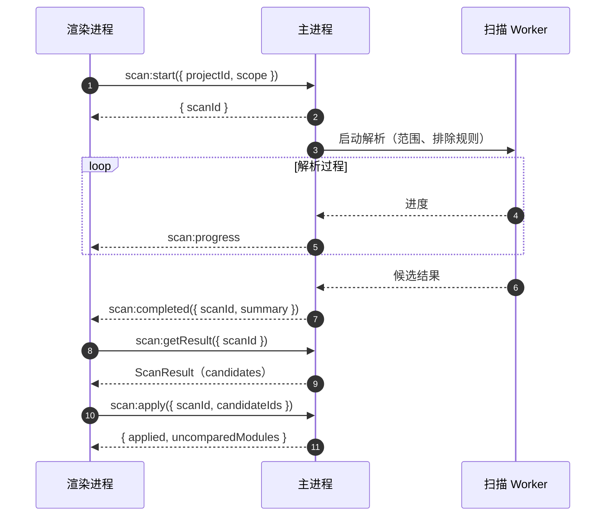
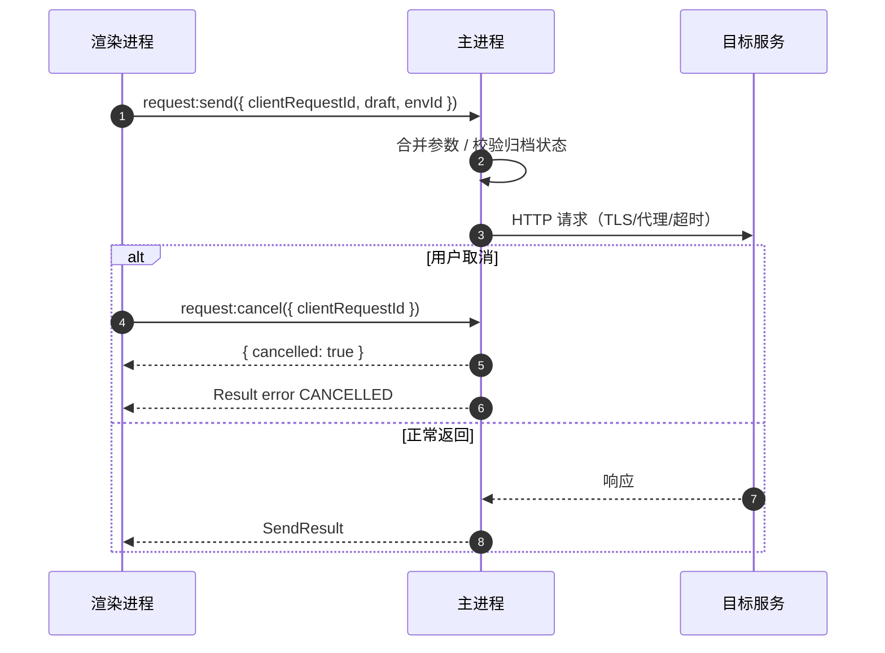
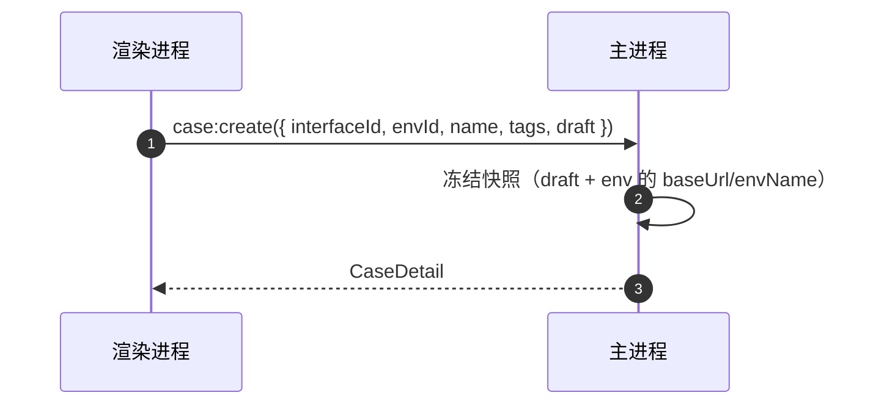

# feelpost IPC 契约设计（设计阶段 05）

> **当前实现状态（2026-11-25）**：本文是设计过程记录，部分内容已随实现演进。AI 接入文档 / `aiDoc:*` 已下线，扫描已 Worker 化，品牌统一为 FeelPost。当前实现以 [`docs/实现现状-2026-11-25.md`](../实现现状-2026-11-25.md) 为准。


| 项 | 内容 |
|---|---|
| 文档版本 | v0.3（草案，待评审；Q1–Q7 已确认；AI 通道已追加） |
| 日期 | 2026-11-24 |
| 依据 | ① `docs/design/01.功能模块梳理.md`（v0.6）；② `docs/design/02.整体架构设计.md`（v0.4）；③ `docs/design/03.数据模型设计.md`（v0.2）；④ `docs/design/04.页面与交互设计.md`（v0.4）；⑤ `06.AI模块详细设计.md` |
| 本文档范围 | 渲染进程 ↔ 主进程的 IPC 通道清单、请求/返回结构、事件、错误码、校验、并发与版本约定 |
| 明确不在本文档范围 | 业务 HTTP 接口（被测服务的接口）、主进程内部服务方法、数据库/文件 schema、页面代码 |

> 本文档只定义"桌面应用内部前后端如何对话"，不定义 feelpost 要测试的那些 REST 接口。

---

## 1. 设计目标

1. **渲染进程零特权**：不直接访问文件系统、不发网络请求、不感知 Electron API；所有能力经白名单通道。
2. **契约可校验**：入参在边界用 zod 校验，返回统一成功/失败结构，界面只处理错误码与消息。
3. **长任务可取消**：扫描与请求都有明确的取消语义，不会留下悬挂的 Promise。
4. **事件可重放**：扫描进度以事件推送，结果可再取（`scan:getResult`），不依赖事件顺序完成业务。
5. **可演进**：通道命名稳定、返回结构带版本，新增字段向后兼容。

---

## 2. 传输与命名

| 项 | 约定 |
|---|---|
| 传输方式 | `ipcRenderer.invoke` / `ipcMain.handle`（请求-响应）；`webContents.send` / `ipcRenderer.on`（主→渲染事件） |
| 通道命名 | `domain:action`，小写、冒号分隔，如 `project:list`、`scan:start` |
| 事件命名 | `domain:event`，如 `scan:progress`、`scan:completed` |
| 暴露方式 | preload 暴露按域分组的对象：`window.feelpost.project.list()`，不透传 channel 名 |
| 参数形态 | 单对象参数 `{ ... }`，禁止位置参数 |
| 返回形态 | 统一 `Result<T>`，不直接 throw 业务错误 |
| 版本 | 契约版本 `1`，由 `app:getInfo` 返回；渲染进程启动时校验 |

### 2.1 结果包络

```ts
type Result<T> =
  | { ok: true; data: T }
  | { ok: false; error: AppError };

interface AppError {
  code: ErrorCode;
  message: string;          // 可直接展示的中文提示
  details?: Record<string, unknown>; // 字段路径、状态码等，不展示给普通用户
  retryable?: boolean;
}
```

### 2.2 错误码

| 错误码 | 语义 | 典型场景 |
|---|---|---|
| `VALIDATION` | 入参不合法 | 必填缺失、URL 非法、超时为负 |
| `NOT_FOUND` | 目标不存在 | 项目/接口/用例/扫描会话不存在 |
| `CONFLICT` | 状态冲突 | 已有扫描进行中、切换默认环境冲突、路径重复 |
| `IO` | 文件读写失败 | 数据目录不可写、文件损坏 |
| `PARSE` | 解析失败 | 扫描器无法解析、快照损坏 |
| `NETWORK` | 网络错误 | DNS、连接拒绝、连接重置 |
| `TLS` | 证书错误 | 自签证书未关闭校验 |
| `PROXY` | 代理错误 | 代理不可达、代理认证失败 |
| `TIMEOUT` | 请求超时 | 超过环境超时配置 |
| `CANCELLED` | 用户取消 | 扫描/请求被取消 |
| `UNSUPPORTED` | 不支持的操作 | 归档接口发送、非 Spring 工程 |
| `AI_NOT_CONFIGURED` | AI 未启用或配置不完整 | 未填 Base URL / Model / Key |
| `AI_AUTH` | AI 认证失败 | 401/403 |
| `AI_RATE_LIMIT` | AI 额度/频率限制 | 429 |
| `AI_NETWORK` | AI 端点不可达 | DNS、连接失败 |
| `AI_TIMEOUT` | AI 调用超时 | 超过 AI 超时配置 |
| `AI_INVALID_OUTPUT` | AI 输出不合法 | JSON/schema/字段路径校验失败 |
| `AI_CANCELLED` | AI 生成被取消 | 用户取消 |
| `INTERNAL` | 未预期错误 | 兜底，提示查看日志 |

> `message` 用中文、面向用户；`details` 放调试信息（字段名、URL、原始错误），不直接展示。

---

## 3. 通用 DTO（只列契约形态）

> 完整字段以数据模型 03 为准；这里只列 IPC 传输需要的最小/显式形状。

```ts
interface ProjectSummary {
  id: string; name: string; sourceDir: string;
  interfaceCount: number; caseCount: number; envCount: number;
  lastScanAt: string | null;          // ISO UTC
}

interface ProjectDetail extends ProjectSummary {
  description: string;
  excludePatterns: string[];
  schemaVersion: number;
  environments: Environment[];
  globalParams: ParamSet;
}

type ParamLocation = 'path' | 'query' | 'header' | 'cookie' | 'body';

interface ParamRow { key: string; value: string; enabled: boolean }

interface ParamField {
  location: ParamLocation;
  path: string;            // 支持 items[].skuId
  name: string;
  type: string;
  required: boolean;
  defaultValue?: string;
  description?: string;
  children?: ParamField[];
}

interface ParamSet {
  path: ParamField[];
  query: ParamField[];
  headers: ParamField[];
  cookies: ParamField[];
}

interface BodyDefinition {
  type: 'json' | 'form' | 'multipart';
  fields: ParamField[];       // location=body
  sample?: unknown;
}

interface Environment {
  id: string; name: string; baseUrl: string;
  params: { headers: ParamRow[]; query: ParamRow[]; cookies: ParamRow[]; body: ParamRow[] };
  verifyTls: boolean;
  proxy: string;
  noProxy: string[];
  timeoutMs: number;
  isDefault: boolean;
}

interface InterfaceSummary {
  id: string;
  method: 'GET' | 'POST' | 'PUT' | 'PATCH' | 'DELETE';
  path: string;
  name: string;
  status: 'registered' | 'changed' | 'archived';
  parseQuality: 'full' | 'partial' | 'failed';
  source: 'scan' | 'manual';
  module: string | null;
  packageName: string | null;
  flags: { dirChanged?: boolean };
}

interface InterfaceDetail extends InterfaceSummary {
  summary: string;
  controller: string | null;
  sourceLayer: {
    params: ParamSet;
    body: BodyDefinition | null;
    parsedAt: string;
    parserVersion: string;
    issues: string[];
  };
  manualLayer: {
    overrides: ParamOverride[];
    summary?: string;
    updatedAt: string;
  } | null;
  examples: ResponseExample[];
  changeNote?: string;
}

interface ParamOverride {
  location: ParamLocation;
  path: string;
  values: Partial<Pick<ParamField, 'name' | 'type' | 'required' | 'defaultValue' | 'description'>>;
}

interface ResponseExample {
  id: string; apiId: string; name: string; status: number;
  headers: Array<[string, string]>;
  body: string; truncated: boolean;
  sourceCaseId?: string; savedAt: string;
}

interface CaseSummary {
  id: string; name: string; apiId: string;
  method: string; path: string; interfaceName: string;
  envId: string; envName: string;   // 保存时快照
  tags: string[]; note: string;
  savedAt: string; updatedAt: string;
}

interface CaseDetail extends CaseSummary {
  requestSnapshot: {
    method: string; path: string;
    baseUrl: string;                // 保存时快照
    pathParams: ParamRow[]; query: ParamRow[];
    headers: ParamRow[]; cookies: ParamRow[];
    bodyType: 'json' | 'form' | 'multipart';
    bodyRaw: string;
    formRows: ParamRow[];
    files: Array<{ key: string; name: string; size: number }>;
  };
}

interface RequestDraft {
  pathParams: ParamRow[];
  query: ParamRow[];
  headers: ParamRow[];
  cookies: ParamRow[];
  bodyType: 'json' | 'form' | 'multipart';
  bodyRaw: string;
  formRows: ParamRow[];
  files: Array<{ key: string; name: string; size: number; path?: string }>;
}

interface ScanScope {
  type: 'all' | 'directory' | 'modules';
  directory?: string;       // type=directory
  modules?: string[];       // type=modules：Maven 模块名
  packages?: string[];      // type=modules：package 名（可选，缺省=模块全部）
}

interface ScanCandidate {
  candidateId: string;      // 仅本次扫描内有效
  kind: 'new' | 'changed' | 'deleted';
  method: string;
  path: string;
  name: string;
  interfaceId?: string;     // changed/deleted
  parseQuality?: 'full' | 'partial' | 'failed';
  diff?: string[];
  affectedCaseCount?: number;
}

interface ScanSummary {
  newCount: number; changedCount: number; deletedCount: number;
  uncomparedModules: string[];
}

interface ScanResult {
  scanId: string;
  projectId: string;
  scope: ScanScope;
  summary: ScanSummary;
  candidates: ScanCandidate[];
}

interface SendResult {
  clientRequestId: string;
  status: number;
  statusText: string;
  headers: Array<[string, string]>;
  bodyText: string;
  bodyTruncated: boolean;
  sizeBytes: number;
  totalMs: number;
  finalUrl: string;
}
```

---

## 4. 通道清单

### 4.1 应用与设置

| 通道 | 入参 | 返回 | 主要错误 |
|---|---|---|---|
| `app:getInfo` | — | `{ version, platform, dataDir, contractVersion }` | INTERNAL |
| `settings:get` | — | `Preferences` | IO |
| `settings:update` | `Partial<Preferences>` | `Preferences` | VALIDATION / IO |
| `dialog:chooseDirectory` | `{ title?: string }` | `{ path: string } \| null` | — |
| `shell:openPath` | `{ path: string }` | `void` | VALIDATION / IO |
| `data:relocate` | `{ targetDir: string }` | `{ moved: boolean; requiresRestart: boolean }` | VALIDATION / CONFLICT / IO |
| `app:log` | `{ level: 'info' \| 'warn' \| 'error', message: string, context?: Record<string, unknown> }` | `void` | — |

**说明**
- `settings:update` 只接受主题、调试日志、窗口状态等偏好；**数据目录变更走 `data:relocate`**。
- `shell:openPath` 只允许打开数据目录、日志目录；路径在允许根内校验。
- `data:relocate` 为预留通道，**v1 不开放**（Q3 后置）：设置页只展示数据目录与“打开目录”。
- `app:log` 只写本地日志，默认脱敏；`context` 不允许包含请求/响应体与凭据（Q6）。

### 4.2 项目

| 通道 | 入参 | 返回 | 主要错误 |
|---|---|---|---|
| `project:list` | — | `ProjectSummary[]` | IO |
| `project:get` | `{ projectId }` | `ProjectDetail` | NOT_FOUND / IO |
| `project:create` | `{ name, sourceDir, description?, localEnvUrl? }` | `ProjectDetail` | VALIDATION / CONFLICT / IO |
| `project:update` | `{ projectId, patch: { name?, description?, sourceDir?, excludePatterns? } }` | `ProjectDetail` | VALIDATION / NOT_FOUND / IO |
| `project:delete` | `{ projectId }` | `void` | NOT_FOUND / IO |
| `project:setActiveEnvironment` | `{ projectId, envId }` | `void` | NOT_FOUND / VALIDATION |
| `project:validateDirectory` | `{ path }` | `{ valid: boolean; hasBuildFile: boolean; controllerCount: number; reason?: string }` | — |

**说明**
- `project:create` 默认创建"本地"环境并写入默认值；前置 URL 缺省用 `http://localhost:8080`。
- `project:update` 改 `sourceDir` 时主进程给所有既有接口打 `dirChanged` 标记（DQ19）。
- `project:delete` 级联删除项目数据，调用前必须由界面二次确认（契约层不再重复询问）。

### 4.3 扫描

| 通道 | 入参 | 返回 | 主要错误 |
|---|---|---|---|
| `scan:start` | `{ projectId, scope: ScanScope }` | `{ scanId: string }` | VALIDATION / CONFLICT / UNSUPPORTED |
| `scan:cancel` | `{ scanId }` | `{ cancelled: boolean }` | NOT_FOUND |
| `scan:getResult` | `{ scanId }` | `ScanResult` | NOT_FOUND |
| `scan:apply` | `{ scanId, candidateIds: string[] }` | `{ applied: ScanSummary; uncomparedModules: string[] }` | NOT_FOUND / CONFLICT / VALIDATION |
| `scan:getLastRun` | `{ projectId }` | `ScanRunSummary \| null` | NOT_FOUND |

**说明**
- 一次只允许一个活跃扫描；重复 `scan:start` 返回 `CONFLICT`。
- 扫描结果只保存在主进程内存，应用退出后失效（DQ8）。
- `scan:apply` 成功后该 `scanId` 作废，重复应用返回 `NOT_FOUND`。
- `scan:getLastRun` 返回最近一次摘要（范围、计数、未比对模块、时间）。

### 4.4 接口资产

| 通道 | 入参 | 返回 | 主要错误 |
|---|---|---|---|
| `catalog:list` | `{ projectId }` | `CatalogTree` | NOT_FOUND / IO |
| `catalog:get` | `{ projectId, interfaceId }` | `InterfaceDetail` | NOT_FOUND |
| `catalog:updateManual` | `{ projectId, interfaceId, manualLayer }` | `InterfaceDetail` | VALIDATION / NOT_FOUND |
| `catalog:confirmChange` | `{ projectId, interfaceId }` | `InterfaceSummary` | NOT_FOUND / CONFLICT |
| `catalog:restore` | `{ projectId, interfaceId }` | `InterfaceSummary` | NOT_FOUND / CONFLICT |
| `catalog:createManual` | `{ projectId, method, path, name, summary? }` | `InterfaceDetail` | VALIDATION / CONFLICT |

```ts
interface CatalogTree {
  modules: Array<{
    name: string;
    packages: Array<{ name: string; interfaces: InterfaceSummary[] }>;
    interfaceCount: number;
  }>;
  manual: InterfaceSummary[];   // 根级“手工接口”分组（DQ4）
}
```

**说明**
- 不存在 `catalog:delete`：接口只归档，不物理删除（DQ10）。
- `catalog:updateManual` 的 `manualLayer` 是字段级覆盖集合；主进程校验定位字段存在。
- `catalog:confirmChange` 只对 `status=changed` 生效；否则 `CONFLICT`。
- `catalog:restore` 只对 `status=archived` 生效；恢复为 `registered`。

### 4.5 环境与参数

| 通道 | 入参 | 返回 | 主要错误 |
|---|---|---|---|
| `env:list` | `{ projectId }` | `Environment[]` | NOT_FOUND / IO |
| `env:create` | `{ projectId, name, baseUrl }` | `Environment` | VALIDATION / CONFLICT |
| `env:update` | `{ projectId, envId, patch: Partial<Environment> }` | `Environment` | VALIDATION / NOT_FOUND |
| `env:delete` | `{ projectId, envId }` | `void` | NOT_FOUND / CONFLICT |
| `env:setDefault` | `{ projectId, envId }` | `Environment[]` | NOT_FOUND / CONFLICT |
| `env:previewEffective` | `{ projectId, envId, interfaceId?, draft? }` | `EffectiveParams` | NOT_FOUND / VALIDATION |

```ts
interface EffectiveParams {
  path: ParamRow[];
  query: Array<ParamRow & { source: 'global' | 'env' | 'interface'; overrides: number }>;
  headers: Array<ParamRow & { source: 'global' | 'env' | 'interface' | 'auto'; overrides: number }>;
  cookies: Array<ParamRow & { source: 'global' | 'env' | 'interface'; overrides: number }>;
  bodyText: string;   // 合并后的请求体文本（body 仅补缺）
}
```

**说明**
- 环境删除不能删最后一个（`CONFLICT`）；默认环境需先切换默认再删。
- `env:previewEffective` 供"生效参数"页展示；与真实发送使用同一合并实现。

### 4.6 请求

| 通道 | 入参 | 返回 | 主要错误 |
|---|---|---|---|
| `request:send` | `{ projectId, envId, interfaceId?, draft: RequestDraft, clientRequestId }` | `SendResult` | NETWORK / TLS / PROXY / TIMEOUT / CANCELLED / VALIDATION / UNSUPPORTED |
| `request:cancel` | `{ clientRequestId }` | `{ cancelled: boolean }` | NOT_FOUND |
| `request:buildCurl` | `{ projectId, envId, interfaceId?, draft }` | `{ curl: string }` | VALIDATION / NOT_FOUND |

**说明**
- `clientRequestId` 由渲染进程生成（UUID），用于取消与结果关联。
- 归档接口发送返回 `UNSUPPORTED`（界面应提前禁用）。
- 超时取环境 `timeoutMs`；不做自动重试（DQ13）。
- 响应体超限截断时 `bodyTruncated=true`，界面提示"响应过大，已截断"。
- 不在主进程持久化请求/响应；保存示例需显式调用 `example:save`。

### 4.7 响应示例

| 通道 | 入参 | 返回 | 主要错误 |
|---|---|---|---|
| `example:save` | `{ projectId, interfaceId, name, response: { status, statusText, headers, bodyText, truncated }, sourceCaseId? }` | `ResponseExample` | VALIDATION / NOT_FOUND |
| `example:update` | `{ projectId, exampleId, patch: { name? } }` | `ResponseExample` | VALIDATION / NOT_FOUND |
| `example:delete` | `{ projectId, exampleId }` | `void` | NOT_FOUND |

**说明**
- 示例内容不可编辑，只能改名或删除（§11 Q1）。
- 示例随接口归档保留，不随项目删除以外的操作删除。

### 4.8 用例

| 通道 | 入参 | 返回 | 主要错误 |
|---|---|---|---|
| `case:list` | `{ projectId, filter?: { tag?, keyword? } }` | `CaseSummary[]` | NOT_FOUND / IO |
| `case:get` | `{ projectId, caseId }` | `CaseDetail` | NOT_FOUND |
| `case:create` | `{ projectId, interfaceId, envId, name, tags?, note?, draft: RequestDraft }` | `CaseDetail` | VALIDATION / NOT_FOUND |
| `case:update` | `{ projectId, caseId, patch: { name?, tags?, note? } }` | `CaseDetail` | VALIDATION / NOT_FOUND / CONFLICT |
| `case:duplicate` | `{ projectId, caseId, name? }` | `CaseDetail` | NOT_FOUND |
| `case:delete` | `{ projectId, caseId }` | `void` | NOT_FOUND |
| `case:buildMd` | `{ projectId, caseIds?: string[] }` | `{ markdown: string }` | NOT_FOUND / IO |

**说明**
- `case:create` 由主进程冻结请求快照（按 draft + env 计算 baseUrl/envName），渲染进程不自行拼快照。
- `case:update` 只允许改名称/标签/备注，改请求快照返回 `CONFLICT`（DQ5）。
- 删除为物理删除，界面二次确认。

### 4.9 文档

| 通道 | 入参 | 返回 | 主要错误 |
|---|---|---|---|
| `doc:build` | `{ projectId, envId, scope: 'all' \| 'registered' \| 'single', interfaceId?, includeManual: boolean }` | `{ markdown, interfaceCount }` | NOT_FOUND / IO |
| `doc:save` | `{ projectId, markdown, suggestedName }` | `{ saved: boolean; path?: string }` | IO |

**说明**
- 主进程负责合并源码层/人工层、生成 6 块 md；渲染进程只预览与触发保存。
- 文本复制（md/curl/响应体）由渲染进程的剪贴板 API 完成，不走 IPC；只有写文件走 `doc:save`（Q5）。
- `doc:save` 打开系统保存对话框；用户取消时 `saved=false`。
- 默认范围见页面设计 UQ6：`registered` + `includeManual=true`。

### 4.10 AI（可选扩展）

> 完整入参/返回结构与数据模型见 `06.AI模块详细设计.md` §7；本节只固定 IPC 通道。

| 通道 | 入参 | 返回 | 主要错误 |
|---|---|---|---|
| `ai:getConfig` | — | `AIConfigPublic` | IO |
| `ai:revealApiKey` | — | `{ apiKey: string }` | IO |
| `ai:updateConfig` | `AIConfig & { apiKey?: string \| null }` | `AIConfigPublic` | VALIDATION / IO |
| `ai:testConnection` | — | `{ ok: true; latencyMs: number }` | AI_NOT_CONFIGURED / AI_AUTH / AI_NETWORK / AI_TIMEOUT |
| `ai:previewContext` | `AIContextInput` | `AIContextPreview` | VALIDATION / NOT_FOUND / AI_NOT_CONFIGURED |
| `ai:generate` | `AIGenerateInput` | `{ requestId: string }` | VALIDATION / CONFLICT / AI_NOT_CONFIGURED |
| `ai:cancel` | `{ requestId }` | `{ cancelled: boolean }` | NOT_FOUND |
| `ai:applyFieldDescriptions` | `{ projectId, interfaceId, target, exampleId?, descriptions, meta }` | `InterfaceDetail` / `ResponseExample` | VALIDATION / NOT_FOUND / IO |
| `ai:importCases` | `{ projectId, interfaceId, envId, cases, meta }` | `CaseSummary[]` | VALIDATION / NOT_FOUND / IO |

**说明**
- API Key 只在 `ai:updateConfig` 入参出现；
- `ai:getConfig` 不返回 Key；只有用户显式调用 `ai:revealApiKey` 才返回当前 Key；
- `ai:previewContext` 返回脱敏后的实际发送对象与 hash；
- `ai:generate` 必须携带同一 hash，hash 不匹配返回 `CONFLICT`；
- `ai:generate` 只启动任务，结果通过事件返回；
- `ai:applyFieldDescriptions` / `ai:importCases` 在主进程再次校验字段路径与快照结构。

### 4.11 AI 文档

| 通道 | 入参 | 返回 | 主要错误 |
|---|---|---|---|
| `aiDoc:list` | `{ projectId }` | `AIDocumentSummary[]` | NOT_FOUND / IO |
| `aiDoc:get` | `{ projectId, documentId }` | `AIDocument` | NOT_FOUND / IO |
| `aiDoc:save` | `{ projectId, documentId?, name, interfaceIds, markdown, typescript, meta }` | `AIDocument` | VALIDATION / NOT_FOUND / IO |
| `aiDoc:insertProjectDoc` | `{ projectId, documentId }` | `AIDocument` | NOT_FOUND / CONFLICT / IO |
| `aiDoc:remove` | `{ projectId, documentId }` | `void` | NOT_FOUND / IO |

**说明**
- `aiDoc:save` 追加版本，最多保留 10 个；
- `aiDoc:insertProjectDoc` 只更新项目 `aiHandoffDocumentId`，项目文档生成时读取最新版本；
- `aiDoc:remove` 删除文档并清空项目指针。

### 4.12 AI 事件（主 → 渲染）

| 事件 | 载荷 | 说明 |
|---|---|---|
| `ai:stream` | `{ requestId, delta }` | SSE 增量文本，仅用于展示 |
| `ai:completed` | `{ requestId, feature, result, meta }` | 结构化结果与 AI 元信息 |
| `ai:failed` | `{ requestId, error: AppError }` | 生成失败 |
| `ai:cancelled` | `{ requestId }` | 用户取消 |

- 事件只带 `requestId`；未知 id 忽略；
- 只有 `ai:completed` 的结果可用于应用；
- 事件不持久化，渲染进程退出即丢失。

### 4.13 扫描事件（主 → 渲染）

| 事件 | 载荷 | 说明 |
|---|---|---|
| `scan:progress` | `{ scanId, phase: 'index' \| 'parse' \| 'compare', message: string, processed?: number, total?: number, percent?: number }` | 100–200ms 自适应节流（Q7） |
| `scan:completed` | `{ scanId, summary: ScanSummary }` | 结果已就绪，随后用 `scan:getResult` 取明细 |
| `scan:failed` | `{ scanId, error: AppError }` | 扫描失败（非取消） |
| `scan:cancelled` | `{ scanId }` | 用户取消 |

**订阅方式**

```ts
const off = window.feelpost.scan.onProgress((payload) => { ... }); // 返回取消订阅函数
```

- 事件只带 `scanId`，渲染进程按当前扫描会话过滤；未知 `scanId` 忽略。
- 事件不保证最终送达；`scan:getResult` 是结果真源。

---

## 5. 关键时序

### 5.1 扫描



### 5.2 发送请求与取消



### 5.3 保存用例



---

## 6. 校验、安全与路径

| 项 | 约定 |
|---|---|
| 入参校验 | 每个通道在主进程用 zod schema 校验；失败返回 `VALIDATION`，`details.field` 指向字段 |
| 通道白名单 | preload 只暴露固定方法，不接受动态 channel 名 |
| 路径来源 | `sourceDir`、`dataDir` 只能来自 `dialog:chooseDirectory` 或已存在项目；手填路径需 `project:validateDirectory` 通过 |
| 路径校验 | 主进程拒绝越权路径（数据目录、项目目录、日志目录之外） |
| 渲染进程权限 | `nodeIntegration=false`、`contextIsolation=true`、`sandbox=true`、CSP 禁止外链 |
| 敏感数据 | 凭据不出主进程日志；错误 `details` 不包含 cookie/token；AI API Key 只存 safeStorage，不返回渲染进程 |
| AI 上下文 | 只发送允许的接口/示例/用例；默认不发送源码；发送前展示脱敏预览 |
| AI 输出 | 主进程校验 JSON/schema/字段路径后才发 `ai:completed`；不直接写入资产 |
| 大载荷 | 响应体超过上限截断并标记；扫描候选一次性返回（1000 条量级，Q1），不做分片 |

---

## 7. 并发、幂等与生命周期

| 场景 | 规则 |
|---|---|
| 扫描并发 | 全局同一时刻只允许一个活跃扫描；再次 `scan:start` 返回 `CONFLICT` |
| 扫描会话 | `scanId` 在内存中保留到 apply/cancel/失败/应用退出；过期后 `getResult` 返回 `NOT_FOUND` |
| 扫描取消 | 取消后结果丢弃，不可恢复（DQ8）；`scan:cancel` 幂等 |
| 请求并发 | 允许并发；`clientRequestId` 由渲染进程保证唯一 |
| AI 生成 | 每个窗口同一时刻只允许一个活跃 AI 生成；再次生成返回 `CONFLICT` |
| AI 取消 | `ai:cancel` 幂等；取消后不写资产 |
| AI 文档 | 版本最多 10 个；插入项目文档为幂等操作 |
| 请求取消 | 只对进行中的请求有效；完成后取消返回 `cancelled=false` |
| 用例编辑 | 允许并发编辑，后写覆盖；不做乐观锁（单用户） |
| 项目切换 | 扫描/请求进行中**阻止切换项目**并提示“请等扫描结束或取消”（Q4）；不提供后台多项目扫描 |

---

## 8. 版本与兼容

- `contractVersion` 从 1 开始；破坏性变更（改字段语义/删通道）必须升版本，渲染进程启动时校验，不匹配则提示升级安装包。
- 新增可选字段、新增通道属于兼容变更，不升大版本。
- 事件载荷只增不改；消费端必须容忍未知字段。
- 主进程与渲染进程随安装包同版本发布，不做跨版本共存，但仍保留版本校验用于诊断。

---

## 9. 测试策略

| 层 | 方式 |
|---|---|
| 契约 schema | 对每个通道的 zod schema 做单测（合法/非法样例） |
| 主进程服务 | 以内存存储 + 假扫描器跑服务单测；断言 `Result` 与错误码 |
| 渲染进程 | mock `window.feelpost`，测试页面状态与错误提示 |
| E2E | Playwright 启动 Electron：建项目 → 扫描 → 入库 → 发送（本地 mock server）→ 存用例 → 导出 |
| 事件 | 断言 `scan:progress` 节流、`completed` 后可取结果、取消后无结果 |

---

## 10. 与页面 / 模块的映射

| 页面/模块 | 主要通道 |
|---|---|
| P-01 / P-02 / P-03 项目 | `project:*`、`dialog:chooseDirectory` |
| P-04 工作台壳 | `app:getInfo`、`settings:*`、`project:setActiveEnvironment` |
| P-05 接口调试 | `catalog:get`、`request:send/cancel/buildCurl`、`env:previewEffective`、`example:*`、`case:create`、`catalog:confirmChange/restore`、`ai:previewContext/generate/applyFieldDescriptions` |
| P-06/P-07/P-08 扫描 | `scan:*`（含事件） |
| P-09/P-10 手工与校正 | `catalog:createManual`、`catalog:updateManual` |
| P-11/P-12 用例 | `case:list/get/update/duplicate/delete/buildMd`、`ai:previewContext/generate/importCases` |
| P-13 文档 | `doc:build/save`、`aiDoc:list/get/save/insertProjectDoc/remove` |
| P-14 环境 | `env:*` |
| P-15 设置 | `settings:*`、`data:relocate`、`shell:openPath`、`ai:getConfig/updateConfig/testConnection` |
| P-16 AI 接入文档 | `aiDoc:*`、`ai:previewContext/generate` |

---

## 11. 已确认结论（2026-11-20）

| 编号 | 问题 | 结论 |
|---|---|---|
| Q1 | 扫描候选返回方式 | **A. 一次性返回**（1000 条量级；超 2000 再评估分页） |
| Q2 | 请求取消 | **A. 纳入 v1**（`clientRequestId` + `request:cancel`） |
| Q3 | 数据目录更换 | **A. 后置**；v1 只展示路径与打开目录，`data:relocate` 暂不开放 |
| Q4 | 扫描中切换项目 | **A. 阻止并提示**，不做后台多项目扫描 |
| Q5 | 复制与文件保存 | **A. 文本复制走渲染进程，文件保存走 `doc:save`** |
| Q6 | 前端日志上报 | **A. 暴露 `app:log`，默认脱敏**，不含请求/响应体与凭据 |
| Q7 | 进度节流 | **A. 100–200ms 自适应** |

> 契约层面的待确认项已清零；AI 扩展追加通道后仍保持向后兼容。

### AI 扩展（2026-11-24）

| 编号 | 问题 | 结论 |
|---|---|---|
| AIQ1 | AI 运行方式 | OpenAI-compatible BYOK；单配置；API Key 使用 safeStorage |
| AIQ2 | 上下文确认 | 首次与 hash 变化时必须先 `ai:previewContext`，`ai:generate` 校验 hash |
| AIQ3 | 生成结果 | 只通过事件返回；只有 `ai:completed` 可应用；不自动写入 |
| AIQ4 | 并发 | 每个窗口同一时刻一个活跃生成任务 |
| AIQ5 | AI 文档 | 独立版本化文档；项目文档只保存插入指针 |
| AIQ6 | 兼容性 | 新增 AI 通道和错误码属于兼容变更，不升 contractVersion |
| AIQ7 | Key 降级 | safeStorage 不可用时仅当前会话保存，不落明文 |
| AIQ8 | AI 用例环境 | 导入时使用当前工作区环境，入参带 `envId` |

## 12. 变更记录

| 版本 | 日期 | 变更 |
|---|---|---|
| v0.1 | 2026-11-20 | 初稿：统一结果/错误约定、45 个通道、4 个事件、3 条关键时序、7 个待确认 |
| v0.2 | 2026-11-20 | 确认 Q1–Q7；新增 `app:log` 通道（共 46 个）；`data:relocate` 标记为 v1 不开放；补充切项目与剪贴板约定 |
| v0.3 | 2026-11-24 | AI 扩展：新增 AI 配置/上下文/生成/应用/文档通道与事件；追加 AI 错误码；上下文与 Key 安全约束 |
