# feelpost 页面原型（可交互）

依据 `docs/需求基线-v1.md` 制作的前端原型：**纯 HTML / CSS / JS，无构建、无依赖、无 CDN、不联网可用**。
只表达交互与信息架构，不包含服务端逻辑；所有请求均为前端模拟。

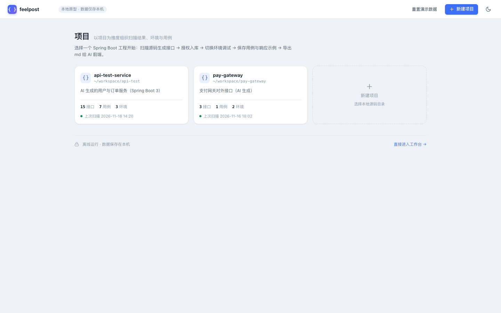

## AI 模块原型（新增）

基于 `docs/design/06.AI模块详细设计.md` 的独立效果稿，沿用现有原型的布局、组件、浅色/深色主题。所有 AI 生成、应用、导入均为前端模拟，**不调用真实模型**。

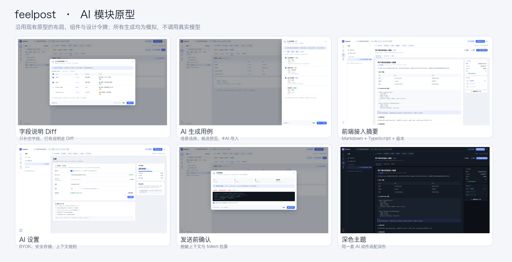

打开 [ai.html](ai.html)，可切换五个场景：

- **字段说明 Diff**：请求体 / 响应字段 AI 补全，已有说明不直接覆盖；
- **AI 用例**：场景选择、候选卡片、`#AI` 标签、预览后导入；
- **前端接入摘要**：Markdown + TypeScript、AI 元信息、版本历史、插入项目文档；
- **AI 设置**：BYOK、API Key 安全存储、上下文脱敏、token 用量；
- **上下文预览**：发送前确认、脱敏字段、token 估算。

同一套组件适配浅色 / 深色主题，深色效果见 [ai-06-dark.png](preview/ai-06-dark.png)。

支持深链接：

```
ai.html?view=fields
ai.html?view=cases
ai.html?view=handoff
ai.html?view=settings
ai.html?view=context
ai.html?view=handoff&theme=dark
```

## 打开方式

```bash
# 方式一：直接双击
open index.html

# 方式二：起一个静态服务（可选）
python3 -m http.server 8080
# 浏览器访问 http://localhost:8080
```

推荐 Chrome / Edge（已在 Chrome 158 验证）；窗口宽度建议 ≥ 1280。

## 3 分钟演示路径

1. **项目列表** → 打开 `api-test-service`。
   - 也可以点「新建项目」：源码目录既可直接粘贴路径，也可点 **选择目录** 调用系统目录选择器；
     选中后会自动回填工程根目录，并识别 `pom.xml` / `build.gradle` 与 Controller 数量。

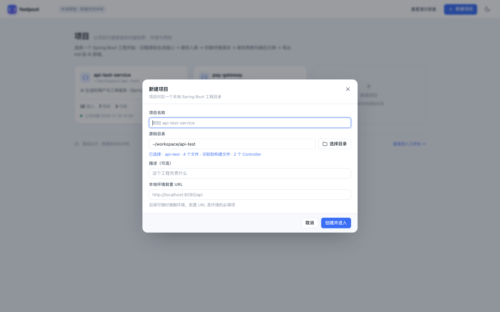
2. 点右上角 **扫描** → 先选扫描范围：
   - **整个工程**（默认）：全部接口一起比对；
   - **指定目录**：只扫某个子目录，可点「选择目录」或直接用示例目录（用户/订单/报表）；
   - **指定模块**：Maven 模块 → 包 两级树，模块可整选/半选、可折叠，只在这些范围内比对，其余接口不动。

   选好后开始扫描 → 观察日志与进度 → 结果页显示对应范围内的 *新增 / 变更 / 删除* → 保持全选 → **确认入库**。

   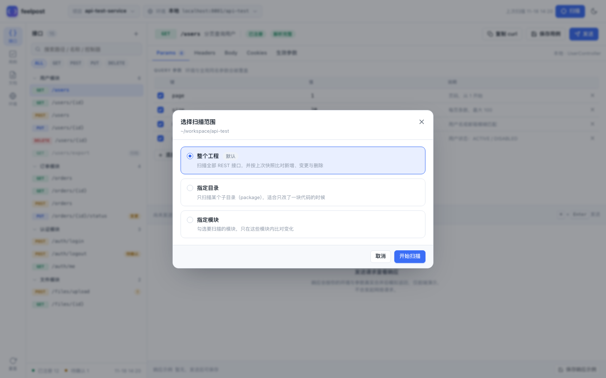

   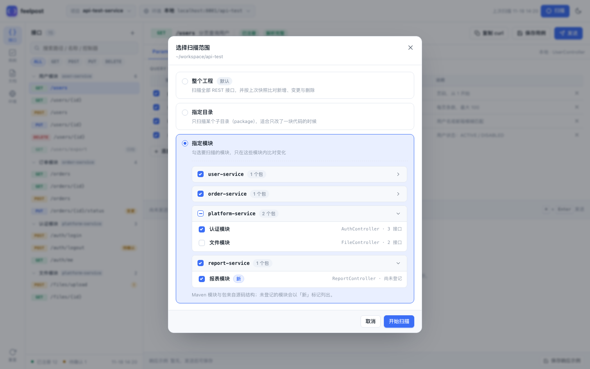
   - 入库后左树出现「报表模块」，新增接口带 `新增` 标记；
   - `PUT /orders/{id}/status` 与 `POST /users` 变为 `已变更`，详情页顶部有变更说明；
   - `GET /users/export` 变为 `已归档`。
   - 新增对齐能力：扫描结果顶部提示"未比对模块"；入库后左栏出现「本次扫描」临时筛选；
     接口头有「校正字段」「确认变更」；归档接口可「恢复为已注册」；手工接口单独分组。
3. **切换环境**：点顶栏环境选择器 → 测试 / 生产，观察顶栏前置 URL 与调试页变化；「生效参数」标签展示 *全局 → 环境 → 接口* 的合并结果与来源。
4. **发送请求** → 查看状态码、耗时、大小与高亮 JSON → **保存响应示例** → **保存用例**。
5. 左侧导航 **用例**：7 条种子用例 + 刚保存的用例，可按标签筛选、查看快照、复制 curl、导出 md。
6. **文档**：项目文档（6 块结构）预览 / Markdown 源码切换，复制或下载 `.md`；单接口文档在左栏选择。
7. **环境**：改前置 URL、跳过 HTTPS 校验、填代理、编辑环境参数与全局参数，底部有生效参数预览。

8. 左侧接口树默认 **只显示 Maven 模块列表**，点模块名才展开（展开后包默认展开，可再点包名收起）；右上角「展开全部 / 收起全部」一键切换，折叠状态在搜索时保留。

   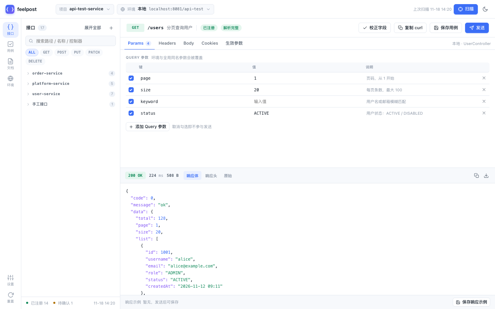

   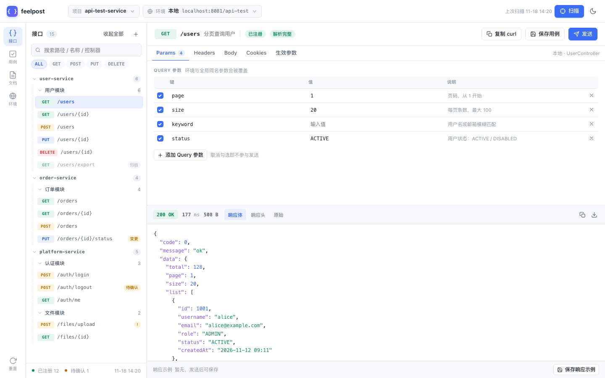
9. **设置**（左轨底部）：主题、数据目录、调试日志；**项目设置**（顶栏项目菜单）：重命名、换目录（会把既有接口标记"目录已变更"）、排除规则、删除项目。
10. 右上角 **月亮/太阳** 切换深色主题；左下角 **重置** 恢复演示数据。
11. **AI 模块原型**：打开 `ai.html`，按顶部场景切换查看字段说明、AI 用例、前端接入摘要、AI 设置和上下文预览。

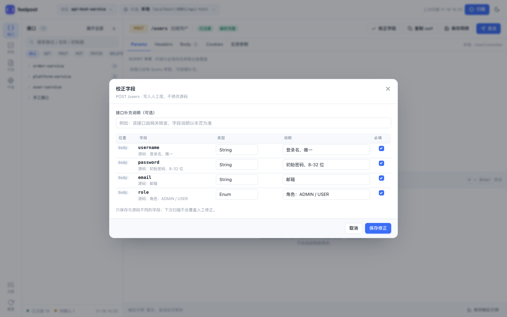

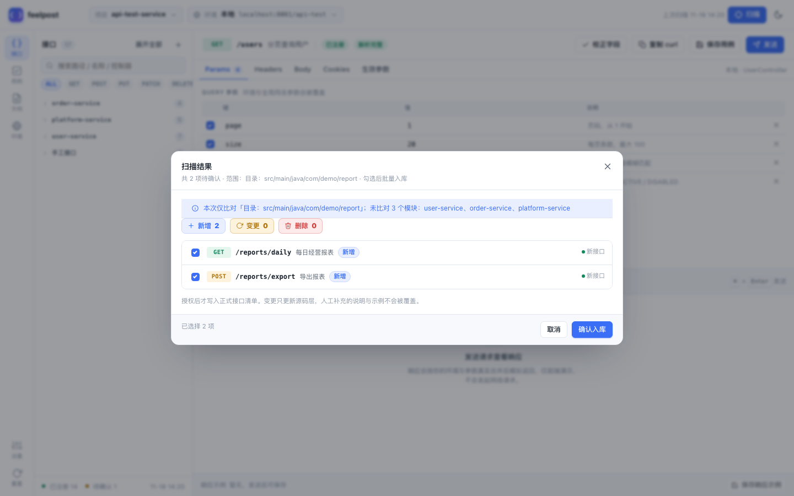

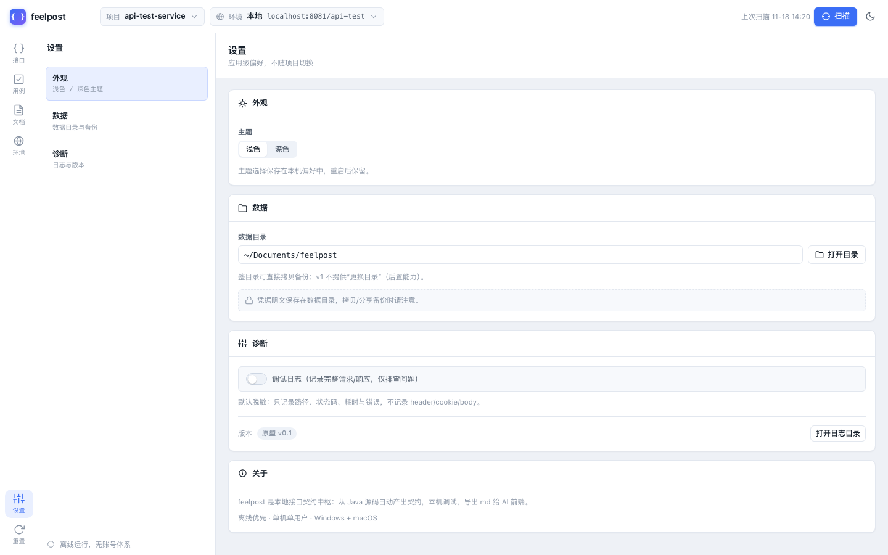

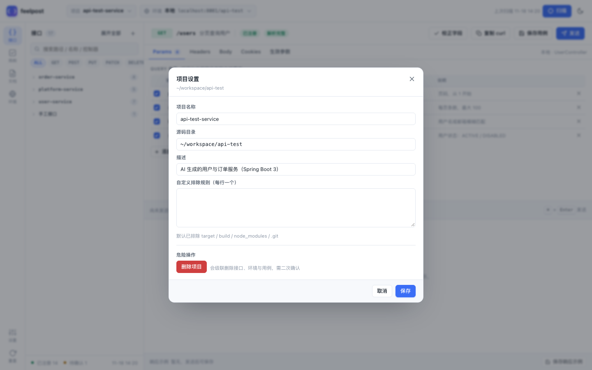


## 已实现的交互（对照基线）

| 基线模块 | 原型落点 |
|---|---|
| 项目维度 | 项目列表、新建项目（含系统目录选择器）、项目切换、项目设置（重命名/换目录/排除规则/删除）、卡片统计 |
| 扫描与索引 | 扫描范围选择（整工程 / 指定目录 / Maven 模块→包两级树）、进度与日志、解析完整度标记（`部分解析`）、**未比对模块提示**、**本次扫描临时筛选**、接口树默认收起为模块列表并可展开到包/接口（支持展开全部）、搜索与方法筛选 |
| 注册与生命周期 | 待确认队列（分类勾选、批量授权）、四态状态机、变更说明与**确认变更**、归档提示与**恢复为已注册**、**手工接口根级分组**、**字段级人工校正** |
| 环境与全局参数 | 环境切换即整套生效、环境覆盖全局、生效参数合并视图、证书校验与代理、**环境超时**、Body 默认值补入 |
| 调试 | 支持 GET / POST / PUT / **PATCH** / DELETE；Params / Headers / Body / Cookies / 生效参数五个标签，JSON / 表单 / 文件上传三种请求体，JSON 格式化、拖拽分栏 |
| 用例 | 手动保存请求快照、多组用例、标签筛选、汇总统计、快照详情、**重命名 / 复制用例**、复制 curl、导出 md、环境已删除标记 |
| 文档导出 | 标准 6 块（清单 / URL / 参数表 / 请求示例 / 响应示例 / 字段说明），不含用例与鉴权要求（Q23）；**包含手工接口开关** |
| 主题与设置 | 浅色 / 深色；应用设置页（数据目录、调试日志、版本）；选择本地持久化 |
| AI 扩展（效果稿） | `ai.html`：字段说明 Diff、AI 用例、前端接入摘要、AI 设置、上下文预览、深色主题 |

## 深链接（便于评审直接跳转）

```
app.html?project=proj-feelpost&theme=dark#workspace
app.html?project=proj-feelpost#workspace&scan=1                 # 直接打开扫描结果
app.html?project=proj-feelpost#workspace&api=api-user-create&tab=body
app.html?project=proj-feelpost#workspace&api=api-users-list&send=1
app.html?project=proj-feelpost#docs&mode=source
ai.html?view=fields                 # AI 字段说明
ai.html?view=handoff                # AI 前端接入摘要
ai.html?view=settings               # AI 设置
```

支持参数：`api`、`tab`（params/headers/body/cookies/effective）、`send`、`scan`、`mode`（preview/source）、`theme`（light/dark）。

## 原型边界（有意不实现）

- **不发起真实 HTTP 请求**：响应是按种子数据生成的模拟结果（含状态码、耗时、响应头）。
- **AI 原型不调用真实模型**：字段说明、用例、接入摘要与 token 数均为演示数据，不读取项目真实接口。
- **扫描是模拟的**：不读取真实 Java 源码，变更集固定为演示数据的一轮；确认入库后再次扫描会提示"没有发现变更"。
- 扫描范围中的「模块」按 Maven 模块 → 包两级模拟（`user-service` / `order-service` / `platform-service` / `report-service`）；指定目录时用所选目录里的 `*Controller.java` 反推模块，取不到再按目录名关键字兜底。
- **数据存在浏览器 localStorage**，不是真实的本地 JSON 文件；重置数据用首页「重置演示数据」。
- 无断言与自动回归、无账号与多人协作、无导入 Postman/Apifox（与基线 v1 一致）。
- 凭据为明文（基线 Q17 的选择），仅演示用途。
- **目录选择器受浏览器安全限制**：只能拿到所选目录的名称与文件清单，拿不到绝对路径；
  原型按 `~/workspace/<目录名>` 近似回填。真实桌面端（Electron / Tauri）可直接返回绝对路径。

## 目录结构

```
prototype/
├── index.html              项目列表
├── app.html                工作台（接口/用例/文档/环境）
├── ai.html                 AI 模块原型（字段说明 / 用例 / 接入摘要 / 设置 / 上下文）
├── preview/                界面截图
└── assets/
    ├── css/main.css        设计令牌、浅色/深色主题、全部组件
    └── js/
        ├── util.js         参数合并、curl、markdown、高亮、剪贴板
        ├── data.js         演示数据与模拟响应
        ├── store.js        localStorage 状态
        ├── ui.js           图标、Toast、弹窗
        ├── ai-prototype.js AI 原型场景与模拟交互
        ├── view-workspace.js
        ├── view-cases.js
        ├── view-docs.js
        ├── view-envs.js
        ├── app-core.js     外壳、导航、扫描流程、发送/保存动作
        └── page-projects.js
```

## 待你确认的原型层面取舍

- 参数表把「Path / Query」放在同一标签页，Header、Cookie 各占一页，是否贴近你的使用习惯？
- 用例与「待确认队列」目前都在左栏/独立页，是否需要把待确认做成全局提醒（顶栏红点）？
- 文档默认只导出「已注册 / 已变更」，归档接口需切到「全部接口」才出现，这个默认是否符合预期？
